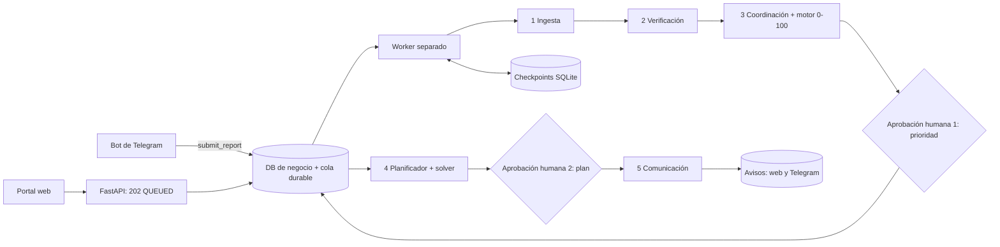

# AguaIA — Coordinación del agua en Panamá Oeste

<!-- Cambia el 0 por el número de su reto y deja la línea tal cual ("Reto: N"):
       1 = Agua · 2 = Educación · 3 = Empleabilidad
     No cambien de reto sin autorización de los organizadores. -->
Reto: 1

## Equipo

- Sebastián Feng (@MrFengH)
- Cristian Muir (@iCrxisz)
- Mahmoud ElSayed (@Matimod55)

## Problema

Arraiján (299,079 habitantes) y La Chorrera (258,221) suman unas 557,300 personas según el Censo 2023
(cifras citadas por Wikipedia a partir del INEC; [F01, F02](docs/DATA_SOURCES.md)). Ambos distritos
dependen de plantas potabilizadoras como Laguna Alta, cuya suspensión programada de 12 horas en 2024
dejó sin servicio a sectores como Nuevo Chorrillo, Burunga y Vista Alegre ([F03](docs/DATA_SOURCES.md)).
El Hospital Regional Nicolás A. Solano, con 250 camas, atiende a cinco distritos ([F05](docs/DATA_SOURCES.md)).

Cuando falta el agua, los reportes llegan dispersos y repetidos. Si las cisternas se reparten por
volumen de quejas o por orden de llegada, el sector que más reporta puede pasar delante de un hospital
o una escuela. AguaIA consolida los reportes, propone prioridades explicables y planifica las
cisternas, siempre con aprobación humana. Es un centro de coordinación, no un chatbot ni un sistema
de despacho automático.

> **Datos:** las cifras anteriores tienen fuente; las poblaciones de sectores, demandas, coordenadas,
> pesos del puntaje y flota son estimaciones o supuestos de demostración, **no datos oficiales del
> IDAAN**. Procedencia y estado de cada dato en [DATA_SOURCES](docs/DATA_SOURCES.md).

## Arquitectura de agentes

Cinco agentes y dos aprobaciones humanas protegidas con token:

1. **Ingesta:** normaliza el reporte con contratos Pydantic (`extra="forbid"`): tipo de problema y
   horas sin agua solo si el texto las sustenta; si el modelo afirma algo que el texto no dice, falla
   cerrado. El sector lo elige el ciudadano de un catálogo.
2. **Verificación:** busca incidentes del mismo sector en una ventana de 72 h y evalúa si es el mismo
   problema (`HIGH`, `MEDIUM`, `LOW`). `MEDIUM` exige confirmación humana.
3. **Coordinación:** un motor determinístico calcula un puntaje 0–100 con intervalo
   `score_min`–`score_max` (horas 35, institución crítica 30, vulnerabilidad 20, población 15) y el
   modelo solo redacta la explicación. **Aprobación humana 1:** el coordinador aprueba, corrige o rechaza.
4. **Planificador:** con las prioridades aprobadas, un solver determinístico voraz (sin LLM) asigna
   cisternas, horarios y galones respetando capacidad, acceso vial, turnos y recarga en planta, y
   explica cada parada y cada demanda no atendida. Compara su plan con dos estrategias de referencia
   (por volumen de reportes y por orden de llegada). **Aprobación humana 2:** el coordinador aprueba o
   rechaza el plan y puede excluir cisternas.
5. **Comunicación:** tras aprobar el plan, genera avisos determinísticos por comunidad (`SCHEDULED`
   con hora estimada o `UNSERVED` con motivo), consultables con el código del reporte y enviados por
   Telegram a quien reportó por ese canal.



El 202 no ejecuta el grafo dentro de la petición: reporte y cola se confirman en una transacción, y un
worker local exclusivo recupera trabajos interrumpidos. Aprobar una prioridad o un plan **no confirma
entregas de agua**: programa rutas que un equipo real debe ejecutar.

**Canales.** El chatbot de Telegram guía al ciudadano (consentimiento, distrito, corregimiento, punto
de referencia, tipo, descripción, duración y confirmación), limita a 5 reportes por conversación y
hora, y devuelve el aviso del plan aprobado. Las fotos recibidas se describen con un modelo de visión
de NVIDIA como evidencia orientativa para el coordinador; nunca cambian el puntaje. WhatsApp está
implementado pero apagado sin credenciales de Meta. Detalle en [MESSAGING](docs/MESSAGING.md).

Arquitectura aprobada: [D1–D7](docs/ARCHITECTURE.md) · diagrama para el video:
[architecture.png](docs/images/architecture.png) · límites: [IMPLEMENTATION](docs/IMPLEMENTATION.md) ·
[cola durable](docs/adr/001-durable-worker.md) · [catálogo de agentes](docs/AGENT_CATALOG.md).

## Tecnologías

Python 3.13, FastAPI, Pydantic 2, SQLAlchemy 2.0 async, Alembic, aiosqlite, LangGraph y
AsyncSqliteSaver. React, TypeScript, Vite, Tailwind y TanStack Query. NVIDIA NIM vía cliente
compatible con OpenAI. pytest/cov, Ruff, mypy, Vitest y GitHub Actions. Versiones resueltas en
`backend/uv.lock` y `frontend/package-lock.json`.

## Modos: mock y NVIDIA NIM

| | `LLM_PROVIDER=mock` (por defecto) | `LLM_PROVIDER=nvidia` |
|---|---|---|
| Uso | Pruebas, CI, evals y demo sin red | Demo con inferencia real |
| Proveedor | `MockLLMProvider`: reglas por palabras clave, marcado como simulación | `NvidiaLLMProvider`, endpoint compatible con OpenAI |
| Modelos | Ninguno | `openai/gpt-oss-20b` (texto) y `nemotron-3-nano-omni` (fotos) |
| Requisitos | Nada | `NVIDIA_API_KEY` y acceso a `integrate.api.nvidia.com` |
| Errores | Determinísticos | Timeout de 30 s y hasta dos reintentos de transporte; el error queda visible, **nunca hay fallback al mock** |

Para NIM: en `.env` pon `LLM_PROVIDER=nvidia`, tu `NVIDIA_API_KEY` y deja
`NVIDIA_MODEL=openai/gpt-oss-20b`; reinicia API y worker. Los trabajos existentes conservan su
proveedor: termínalos antes de cambiar o usa otra base. Modelos probados y descartados en
[NVIDIA_SMOKE](docs/NVIDIA_SMOKE.md).

## Instalación y ejecución

Requisitos: Python 3.13, Node 22 y uv 0.13.0. Comprueba `python --version`, `node --version` y
`uv --version`. Si falta uv: `python -m pip install uv==0.13.0`. En Windows, `npm.cmd` evita
restricciones de `npm.ps1`; si `python` abre Microsoft Store, usa `py -3.13`. No se requiere Docker
ni clave LLM para la demo.

Desde la raíz, PowerShell:

```powershell
if (-not (Test-Path .env)) { Copy-Item .env.example .env }
Set-Location backend
uv sync --locked
uv run alembic upgrade head
uv run python -m app.seed
uv run uvicorn app.api:app --host 127.0.0.1 --port 8000
```

Otra terminal para el worker (necesario):

```powershell
Set-Location backend
uv run python -m app.worker
```

Otra para la interfaz:

```powershell
Set-Location frontend
npm.cmd ci
npm.cmd run dev
```

Opcional, el bot de Telegram (requiere `TELEGRAM_BOT_TOKEN` en `.env`):

```powershell
Set-Location backend
uv run python -m app.integrations.telegram
```

Abre `http://localhost:5173`; API y OpenAPI en `http://127.0.0.1:8000/docs`. En Linux usa
`cp -n .env.example .env`, `cd` y `npm` en los mismos pasos.

### Variables

| Variable | Uso |
|---|---|
| `LLM_PROVIDER` | `mock` (simulación explícita) o `nvidia` |
| `COORDINATOR_TOKEN` | Token compartido de mínimo 16 caracteres; sin configurar, la administración falla cerrada |
| `DATABASE_URL`, `CHECKPOINT_PATH` | DB de negocio y archivo de checkpoints; mantenerlos estables entre reinicios |
| `CORS_ORIGINS` | Lista JSON explícita de orígenes permitidos |
| `NVIDIA_API_KEY`, `NVIDIA_MODEL`, `NVIDIA_VISION_MODEL`, `NVIDIA_BASE_URL` | Solo para NIM; la clave nunca va al frontend |
| `LLM_TIMEOUT_SECONDS` | 30 s por intento |
| `DEDUP_WINDOW_HOURS` | 72 h por defecto, configurable 48–168 |
| `RATE_LIMIT_PER_MINUTE` | 30 reportes por IP y minuto, persistido en DB |
| `TELEGRAM_BOT_TOKEN`, `MEDIA_PATH`, `MEDIA_MAX_BYTES` | Bot de Telegram y almacenamiento de fotos y audios |
| `WHATSAPP_*` | Canal WhatsApp; apagado sin credenciales de Meta |

Credencial **pública solo para localhost** incluida en `.env.example`: `demo-local-change-me-aguaia`.
Se introduce en el acceso para coordinadores. Sustitúyela antes de exponer el servicio; no es una identidad individual
ni un secreto de producción. `.env` está excluido de Git.

## Demostración

Escenario reproducible F2-01, desde `backend/` con API y worker encendidos:

```powershell
uv run python ../scripts/seed_demo_scenario.py
```

Carga 12 reportes sintéticos de Panamá Oeste:

- 5 reportes repetidos de Vista Alegre que se consolidan en un incidente;
- tres instituciones críticas: el Hospital Nicolás A. Solano (tanques de reserva por agotarse), la
  C.E.B.G. Guillermo Andreve y el Centro de Salud de Nuevo Chorrillo;
- una fuga por rotura de tubería cerca del parque, que el planificador deriva a cuadrilla
  (`FUGA_REQUIERE_REPARACION`) en vez de mandar cisterna;
- un sector sin coordenadas (`sector-sin-censo`), que queda como `SIN_UBICACION` sin inventar ruta;
- la cisterna `cisterna-hospital-01` excluida por el coordinador.

Recorrido:

1. Entra por **Acceso para coordinadores** (pie de la página ciudadana), ingresa el token, revisa factores, intervalo y trazas de cada
   reporte y aprueba, corrige o rechaza con una razón.
2. En **Plan de distribución de cisternas** marca las cisternas no disponibles, genera el plan y revisa
   paradas, horarios, demanda no atendida y la tarjeta de impacto: «AguaIA frente a por volumen de
   reportes: misma cobertura crítica (100 %) · primera entrega crítica 149 min antes».
3. Aprueba el plan. El agente de Comunicación genera los avisos por comunidad.
4. En la página ciudadana, en «¿Ya hiciste un reporte? Consulta con tu código», usa el código del reporte y verás la hora estimada de llegada,
   sin trazas ni datos de auditoría. Si el reporte llegó por Telegram, el aviso llega al chat.

Guion completo, recuperación y reinicio seguro de datos: [DEMO](docs/DEMO.md).

## Pruebas y evals

Cifras de la última ejecución local (`evals/results.json`, `evals/impact.json`):

- **Backend:** 162 pruebas pytest, cobertura de líneas 87 %.
- **Evals:** 54/54 escenarios de [cases.json](evals/cases.json), en seis grupos que se solapan:
  consolidación, guardrails, prioridad, decisión humana, planificador y robustez. Miden cumplimiento
  de escenarios con el mock, no la calidad de un modelo real.
- **Impacto:** `scripts/impact_report.py` corre el mismo solver con tres órdenes sobre F2-01. La
  mediana de la primera entrega a las instituciones críticas baja de 292 min (por volumen y por
  llegada) a 143 min con AguaIA; la cobertura crítica es 100 % en las tres.
- **Frontend:** 11 pruebas Vitest.

```powershell
# Desde backend
uv run ruff check app tests migrations
uv run ruff format --check app tests migrations
uv run mypy
uv run pytest -q -p no:cacheprovider --cov=app
uv run alembic check
uv run python ../scripts/evaluate.py
uv run python ../scripts/impact_report.py
# Desde frontend
npm.cmd run lint
npm.cmd run typecheck
npm.cmd test
npm.cmd run build
```

Método por capas (funcional, adversos e impacto) y sus límites en [EVALUATION](docs/EVALUATION.md).
Organización: `backend/`, `frontend/`, `evals/`, `data/`, `docs/`, `scripts/`, `.github/`. Guía del
equipo: [CONTRIBUTING](CONTRIBUTING.md), [backlog](docs/BACKLOG.md),
[requisitos](docs/REQUIREMENTS.md), [metodología](docs/METHODOLOGY.md).

## Bitácora de IA

[AI_LOG](docs/AI_LOG.md) registra la implementación asistida, herramientas, alcance y revisión humana.
No se atribuyen actividades ni revisiones que no fueron observadas.
[Checklist oficial](docs/DELIVERY_CHECKLIST.md): video, registro, historial y congelamiento requieren
actuaciones del equipo; no se simulan como terminados.

---

Entrega: tag de git `final-24h` sobre el último commit válido, al cumplirse la hora 24.
