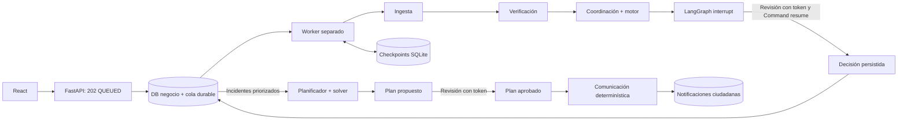

# AguaIA — Coordinación del agua en Panamá Oeste

<!-- Cambia el 0 por el número de su reto y deja la línea tal cual ("Reto: N"):
       1 = Agua · 2 = Educación · 3 = Empleabilidad
     No cambien de reto sin autorización de los organizadores. -->
Reto: 1

## Equipo

- Sebastián Feng (@MrFengH)
- Cristian Muir (@iCrxisz)
- Mahmoud ElSayed (@Matimod55)

## Problema

Los reportes dispersos de falta de agua dificultan coordinar la atención de comunidades de Arraiján
y La Chorrera. AguaIA consolida incidentes y propone prioridades explicables que debe revisar una
persona. Es un centro de coordinación, no un chatbot ni un sistema de despacho automático.

**Estado:** vertical slice local implementado. Mock offline por defecto, cinco agentes,
persistencia real, dos aprobaciones humanas protegidas (prioridad y plan de cisternas) y
trazabilidad. Catálogo de sectores de referencia; no son datos oficiales del IDAAN. Integraciones de
mensajería, tráfico real y despliegue público quedan pendientes.

## Arquitectura de agentes

1. **Ingesta:** normaliza el reporte con contratos Pydantic y conserva información ausente.
2. **Verificación:** consulta candidatos del mismo sector y consolida mediante reglas + evaluación
   semántica tipada. MEDIUM exige resolver la asociación humana.
3. **Coordinación:** utiliza el motor determinístico 0–100 y propone una decisión explicable.
4. **Planificador:** toma los incidentes cuya prioridad aprobó el coordinador y, con un solver
   determinístico (sin LLM), asigna cisternas, horarios y galones respetando capacidad, acceso vial,
   turnos y recarga en planta. Explica cada parada y cada demanda no atendida; el coordinador
   aprueba o rechaza el plan y puede excluir cisternas no disponibles.
5. **Comunicación:** tras la aprobación del plan por el coordinador, consolida y publica avisos
   ciudadanos determinísticos por comunidad (`SCHEDULED` con la hora estimada de llegada más temprana
   y galones totales, o `UNSERVED` con motivo), consultables de forma segura por código de reporte sin
   filtrar trazas ni datos de auditoría.



El 202 no ejecuta el grafo dentro de la petición: reporte y cola se confirman en una transacción.
Un worker local exclusivo recupera trabajos interrumpidos. Las herramientas guardan reportes,
asociaciones, propuestas y decisiones reales. La revisión termina en una prioridad aprobada o
rechazada; **no confirma distribución de agua**.

Arquitectura aprobada: [D1–D7](docs/ARCHITECTURE.md). Detalle implementado y límites:
[IMPLEMENTATION](docs/IMPLEMENTATION.md), [cola durable](docs/adr/001-durable-worker.md),
[catálogo de agentes](docs/AGENT_CATALOG.md).

## Tecnologías y fuentes de datos

Python 3.13, FastAPI, Pydantic 2, SQLAlchemy 2.0 async, Alembic, aiosqlite, LangGraph y
AsyncSqliteSaver. React, TypeScript, Vite, Tailwind y TanStack Query. pytest/cov, Ruff, mypy,
Vitest y GitHub Actions. Versiones resueltas en `backend/uv.lock` y `frontend/package-lock.json`.

El repositorio incluye un catálogo de sectores demostrativos e instituciones de Panamá Oeste. Las
instituciones de salud y plantas existen en la realidad, pero sus poblaciones y demandas son supuestos
de prueba. El catálogo incorpora coordenadas de referencia clasificadas como **estimadas** (tipo ESTIMADO,
no catastro oficial del IDAAN) para posicionamiento y ruteo aproximado. Los pesos del puntaje y las
especificaciones de flota son criterios de demostración. Procedencia completa, fuentes verificadas y
límites en [DATA_SOURCES](docs/DATA_SOURCES.md).

## Instalación y ejecución

Requisitos: Python 3.13, Node 24 y uv 0.13.0. Comprueba `python --version`, `node --version`,
`uv --version`. Si falta uv: `python -m pip install uv==0.13.0`; si falta Python/Node, instala
esas versiones antes de continuar. En Windows, `npm.cmd` evita restricciones de `npm.ps1`.
Si `python` abre Microsoft Store, usa la ruta de tu instalación Python o `py -3.13`.
No se requiere Docker ni clave LLM para la demo.

Desde la raíz, PowerShell:

```powershell
if (-not (Test-Path .env)) { Copy-Item .env.example .env }
Set-Location backend
uv sync --locked
uv run alembic upgrade head
uv run python -m app.seed
uv run uvicorn app.api:app --host 127.0.0.1 --port 8000
```

Abre otra terminal en la raíz para el worker (necesario):

```powershell
Set-Location backend
uv run python -m app.worker
```

Y otra para la interfaz:

```powershell
Set-Location frontend
npm.cmd ci
npm.cmd run dev
```

Abre `http://localhost:5173`; API y OpenAPI en `http://127.0.0.1:8000/docs`.
En Linux usa `cp -n .env.example .env`, `cd` y `npm` en los mismos pasos.
`uv sync` crea el entorno virtual `.venv`; activarlo es opcional porque `uv run` lo selecciona.

### Variables y modos

| Variable | Uso |
|---|---|
| `LLM_PROVIDER` | `mock` (simulación explícita) o `nvidia` |
| `COORDINATOR_TOKEN` | Token compartido de mínimo 16 caracteres; sin configurar, administración falla cerrada |
| `DATABASE_URL` | DB de negocio; ruta SQLite relativa al directorio backend |
| `CHECKPOINT_PATH` | Archivo separado de checkpoints; mantener estable entre reinicios |
| `CORS_ORIGINS` | Lista JSON explícita de orígenes permitidos |
| `NVIDIA_API_KEY`, `NVIDIA_MODEL`, `NVIDIA_BASE_URL` | Solo para NIM; nunca poner la clave en frontend |
| `LLM_TIMEOUT_SECONDS` | 30 s por intento; cliente con máximo dos reintentos de transporte |
| `DEDUP_WINDOW_HOURS` | 72 h por defecto, configurable 48–168 |
| `RATE_LIMIT_PER_MINUTE` | 30 reportes por IP/minuto, persistido en DB |

Credencial **pública solo para localhost** incluida en `.env.example`:
`demo-local-change-me-aguaia`. Introducirla en Coordinación. Sustituirla antes de exponer el servicio;
no es una identidad individual ni un secreto de producción. `.env` está excluido de Git.

Modo NIM: configurar `LLM_PROVIDER=nvidia`, la clave y el modelo verificado
`openai/gpt-oss-20b` (valor de `.env.example`), y reiniciar API y worker.
El adaptador se prueba offline con transporte simulado. También se verificó una ejecución real con
`NVIDIA_MODEL=openai/gpt-oss-20b` hasta la revisión humana, usando NVIDIA NIM y timeout de 30 s.
DeepSeek agotó los timeouts y Kimi K2.6 devolvió 404 en esta cuenta: ver [prueba real](docs/NVIDIA_SMOKE.md).
La disponibilidad de cada endpoint debe comprobarse; nunca hay fallback silencioso.
Los trabajos existentes conservan su proveedor: finalizar antes de cambiarlo o usar otra DB de demo.

### Demostración y pruebas

1. Envía «Estamos sin agua desde hace 24 horas» en el sector demostrativo de Arraiján, duración 24.
2. Observa el identificador y la transición de cola a revisión humana.
3. En Coordinación ingresa el token, selecciona la ejecución y revisa factores, intervalo y trazas.
4. Aprueba, rechaza o corrige con una razón. Espera el estado terminal y verifica la decisión guardada.
5. Repite el reporte para comprobar la consolidación.
6. En «Plan de distribución de cisternas» marca las cisternas no disponibles, genera el plan, revisa
   paradas, horarios y demanda no atendida, y apruébalo o recházalo con una razón. Aprobar programa
   rutas; no confirma entregas de agua.

Guion completo, recuperación y reinicio seguro de datos: [DEMO](docs/DEMO.md).

```powershell
# Desde backend
uv run ruff check app tests migrations
uv run ruff format --check app tests migrations
uv run mypy
uv run pytest -q -p no:cacheprovider --cov=app
uv run alembic check
uv run python ../scripts/evaluate.py
# Desde frontend
npm.cmd run lint
npm.cmd run typecheck
npm.cmd test
npm.cmd run build
```

Organización: `backend/`, `frontend/`, `evals/`, `data/`, `docs/`, `scripts/`, `.github/`.
Guía del equipo: [CONTRIBUTING](CONTRIBUTING.md), [backlog](docs/BACKLOG.md),
[requisitos](docs/REQUIREMENTS.md), [metodología](docs/METHODOLOGY.md).

## Evals

22 escenarios reproducibles en [evals/cases.json](evals/cases.json), ejecutados mediante pytest.
Resultados generados, métricas y límites en [EVALUATION](docs/EVALUATION.md).
Incluyen dedupe, datos incompletos, guardrails, fallos de proveedor, autorización, reanudación y
reintentos. Los resultados offline no miden calidad de los modelos reales.

## Bitácora de IA

[AI_LOG](docs/AI_LOG.md) registra la implementación asistida, herramientas, alcance y revisión
humana pendiente. No se atribuyen actividades previas ni revisiones que no fueron observadas.
[Checklist oficial](docs/DELIVERY_CHECKLIST.md): video, registro, historial y congelamiento
requieren actuaciones del equipo; no se simulan como terminados.

---

Entrega: tag de git `final-24h` sobre el último commit válido, al cumplirse la hora 24.
