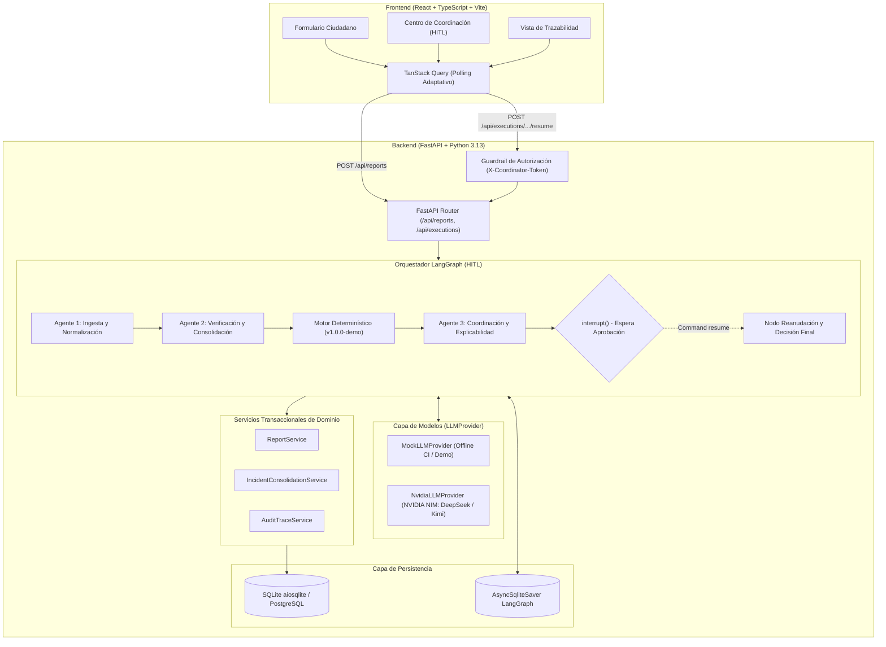
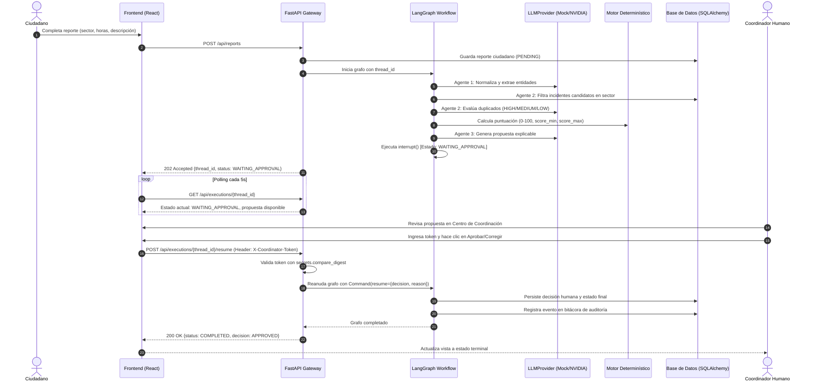

# AGUAIA — ESPECIFICACIÓN ARQUITECTÓNICA Y DISEÑO TÉCNICO

> **Proyecto:** AguaIA — Centro de Coordinación Agéntico para la Crisis del Agua en Panamá Oeste  
> **Evento:** Hackathon FISC AI Agents 2026 — Reto 1: Agua  
> **Equipo:** Sebastián Feng (@MrFengH), Cristian Muir (@iCrxisz), Mahmoud ElSayed (@Matimod55)  
> **Estado:** Aprobado y Consolidado tras sesión de `grill-me` (7/7 decisiones bloqueadas)  
> **Versión:** 1.0.0-draft  

---

## 1. VISIÓN GENERAL Y CONTEXTO

AguaIA es una plataforma agéntica y determinística diseñada para abordar la gestión, verificación y distribución equitativa de agua potable durante contingencias en Panamá Oeste (especialmente en los distritos de Arraiján y La Chorrera).

El sistema supera el modelo de un simple "chatbot ciudadano" transformándose en un **centro de operaciones auditable** que integra:
- Ingesta estructurada de reportes multicanal.
- Deduplicación y consolidación híbrida de incidentes para evitar fragmentación.
- Motor determinístico de priorización independiente de alucinaciones de LLM.
- Orquestación multiagente con **LangGraph** y ciclo estricto de **Human-in-the-Loop (HITL)** para supervisión de decisiones críticas.
- Trazabilidad integral y guardrails multicapa.

---

## 2. DECISIONES ARQUITECTÓNICAS CONSOLIDADAS (GRILL-ME)

A continuación se detallan las siete decisiones fundamentales aprobadas durante la fase de interrogación técnica:

```
                      ÁRBOL DE DECISIONES CONSOLIDADAS
  [D1: Monorepo en equipo-07/]
            │
            ├─► [D2: LangGraph HITL + AsyncSqliteSaver + thread_id]
            │         │
            │         └─► [D3: SQLAlchemy 2.0 Async (aiosqlite -> asyncpg)]
            │
            ├─► [D4: Deduplicación Híbrida (SQL + LLM Categórico Pydantic)]
            │
            ├─► [D5: Motor Determinístico 0-100 (Urgencia vs Incertidumbre)]
            │
            ├─► [D6: LLMProvider (Mock Determinístico + NVIDIA NIM)]
            │
            └─► [D7: TanStack Query Polling + Auth X-Coordinator-Token]
```

### Decisión 1: Estructura del Monorepo y Preservación del Repositorio Oficial
- **Ubicación:** Raíz directa de `LarpOps/equipo-07/`.
- **Estructura física:**
  - `backend/`: API FastAPI, LangGraph, dominio, servicios, persistencia y tests.
  - `frontend/`: Single Page Application en React + TypeScript + Vite + Tailwind CSS.
  - `evals/`: Casos de evaluación reproducibles (mínimo 15) y runner automatizado.
  - `data/`: Catálogo sintético verificado de sectores de Panamá Oeste y scripts de seed.
  - `docs/`: Documentación técnica especializada, ADRs y bitácora.
  - `.github/`: Workflows de CI y plantillas de colaboración.
- **Restricción obligatoria:** Preservar y evolucionar el `README.md` original proporcionado por los organizadores, completando sus secciones oficiales sin sobreescribir la información del equipo ni el identificador del reto.

### Decisión 2: Orquestación Multiagente LangGraph y Ciclo Human-in-the-Loop (HITL)
- **Checkpointer:** `AsyncSqliteSaver` desacoplado bajo una fábrica de persistencia, preparado para migrar a `AsyncPostgresSaver` sin alterar la topología del grafo.
- **Identificador de ejecución:** Cada flujo se asocia a un `thread_id` UUID estable generado al registrar el reporte ciudadano.
- **Interrupción y Reanudación:** 
  - El grafo ejecuta: Ingesta → Verificación/Consolidación → Motor Determinístico → Propuesta de Coordinación.
  - Antes de persistir la decisión final, el grafo invoca `interrupt()` y suspende su ejecución.
  - La petición HTTP inicial responde de inmediato con estado `WAITING_HUMAN_APPROVAL` y el `thread_id`. No se mantienen conexiones HTTP colgadas.
  - La reanudación ocurre mediante el endpoint `POST /api/executions/{thread_id}/resume` que inyecta la decisión humana mediante `Command(resume=...)`.
- **Control de Repetición (Replay):** LangGraph puede reejecutar código anterior al punto de interrupción dentro del nodo al reanudar; las mutaciones en base de datos se ejecutan en nodos independientes de efectos secundarios o mediante operaciones idempotentes.

### Decisión 3: Persistencia Relacional y Ciclo de Vida de Base de Datos
- **ORM y Migraciones:** SQLAlchemy 2.0 completamente asíncrono con `AsyncSession` y `create_async_engine`, gestionado por migraciones asíncronas de Alembic (`env.py` con plantilla async).
- **Driver:** `aiosqlite` para SQLite en desarrollo y pruebas; compatible mediante configuración `.env` con `asyncpg` para PostgreSQL.
- **Separación de Almacenamiento:** Separación estricta entre:
  1. Base de datos relacional de negocio: reportes, incidentes, sectores, propuestas y eventos de auditoría.
  2. Almacenamiento de checkpoints de LangGraph: estado interno y memoria del grafo.
- **Aislamiento transaccional:** Ninguna transacción de base de datos relacional permanece abierta durante la suspensión de LangGraph o mientras se espera la decisión del coordinador humano.

### Decisión 4: Estrategia Híbrida de Deduplicación y Consolidación (Agente 2)
- **Fase 1 (Filtro Determinístico SQL):** Búsqueda de incidentes abiertos o en progreso en el mismo sector/comunidad dentro de una ventana temporal configurable (últimas 48-72 horas, considerando incidentes de larga duración y última actividad).
- **Fase 2 (Evaluación Semántica Tipada):** Si hay candidatos, el modelo de IA evalúa la similitud emitiendo un contrato Pydantic estricto:
  - `match_confidence`: `HIGH`, `MEDIUM` o `LOW` (categórico, sin falsas probabilidades continuas).
  - `matched_incident_id`: UUID validado obligatoriamente contra los candidatos reales filtrados en Fase 1.
  - `reasoning`: Justificación textual explicable.
- **Reglas de Transición:**
  - `HIGH`: Consolidación automática únicamente si se cumplen también las reglas determinísticas de compatibilidad sectorial.
  - `MEDIUM`: Registro de asociación tentativa marcada como `PENDING_REVIEW` sin alterar la relación definitiva del reporte.
  - `LOW`: Creación de un nuevo incidente.
- **Guardrail de Escritura:** Las mutaciones son ejecutadas exclusivamente por servicios transaccionales de dominio con validación de idempotencia, nunca por llamadas directas del LLM a la base de datos.

### Decisión 5: Motor Determinístico de Priorización (0 a 100 Puntos)
- **Independencia del LLM:** Código determinístico puro, versionado bajo `PriorityPolicyConfig` (`v1.0.0-demo`).
- **Ponderaciones Máximas:**
  1. **Horas sin agua:** 35 puntos (crecimiento acotado por tramos).
  2. **Instituciones críticas afectadas:** 30 puntos (hospitales, policlínicas, escuelas, asilos).
  3. **Vulnerabilidad comunitaria:** 20 puntos (factores socioeconómicos y de red del sector verificado).
  4. **Población afectada verificada:** 15 puntos (basado en datos demográficos del sector, **no** en el número de reportes duplicados recibidos para evitar sesgos por spam).
- **Separación entre Urgencia e Incertidumbre:**
  - No se restan puntos por datos faltantes (para no perjudicar a zonas desconectadas o vulnerables).
  - En presencia de datos ausentes, el motor calcula un intervalo explicable: `score_min` y `score_max`.
  - Se genera una métrica de calidad `confidence_level` calculada mediante reglas formales y banderas `flags: ["DATOS_INCOMPLETOS"]`.
  - Si un incidente involucra un centro de salud o institución crítica, se activa una alerta prioritaria de revisión inmediata independientemente de la falta de datos.

### Decisión 6: Capa de Modelos LLM y Modo Demo Offline
- **Interfaz Abstracta:** Protocolo `LLMProvider` con métodos tipados:
  - `extract_report(text: str) -> NormalizedReportSchema`
  - `evaluate_duplicate(report, candidates) -> DuplicateEvaluationSchema`
  - `explain_priority_proposal(incident, priority) -> CoordinationProposalSchema`
- **Proveedores Implementados:**
  1. `MockLLMProvider` (Por defecto): Motor determinístico offline con fixtures reproducibles para los 15 casos de evaluación de CI. Marca todas las respuestas con `is_simulated=True` y `provider="mock-deterministic"`.
  2. `NvidiaLLMProvider`: Adaptador asíncrono para la API de NVIDIA NIM (`https://integrate.api.nvidia.com/v1`) utilizando el cliente `AsyncOpenAI`, soportando modelos como `deepseek-ai/deepseek-v4.1-flash` y `moonshotai/kimi-k3`.
- **Resiliencia:** Salidas validadas mediante Pydantic con reintentos acotados. Si la API de NVIDIA falla durante una ejecución real, el error se propaga de manera controlada; **no** se realiza un fallback silencioso a simulación.

### Decisión 7: Comunicación Frontend-Backend y Seguridad HITL
- **Comunicación:** TanStack Query en el frontend con HTTP Polling adaptativo:
  - Intervalo de 2 segundos durante estado `RUNNING`.
  - Intervalo de 5 segundos durante estado `WAITING_APPROVAL`.
  - Detención automática inmediata cuando el estado es terminal (`APPROVED`, `REJECTED`, `ERROR`) o cuando el componente se desmonta.
- **Autorización HITL:**
  - Encabezado HTTP `X-Coordinator-Token` validado en FastAPI con `secrets.compare_digest` frente a la variable `COORDINATOR_TOKEN`.
  - En el frontend, el token se introduce manualmente en la interfaz de demostración y se almacena **únicamente en la memoria de sesión del estado de React** (nunca en `localStorage`, cookies no seguras ni URLs).
  - Los endpoints de reporte ciudadano permanecen públicos pero protegidos por rate limiting y validación Pydantic estricta.

---

## 3. DIAGRAMAS DE ARQUITECTURA

### Diagrama de Componentes del Sistema



### Diagrama de Secuencia del Vertical Slice (HITL)



---

## 4. ANÁLISIS DE RIESGOS TÉCNICOS Y MITIGACIONES

| Riesgo Técnico Identificado | Impacto | Estrategia de Mitigación Aprobada |
| :--- | :---: | :--- |
| **Concurrencia y Locks en SQLite** | Medio | Configurar SQLite en modo `WAL` (Write-Ahead Logging), timeouts explícitos de conexión, y aislar físicamente el archivo relacional del archivo de checkpoints de LangGraph. |
| **Efectos Secundarios en Replay de LangGraph** | Alto | Diseñar los nodos anteriores a `interrupt()` de forma idempotente. Las mutaciones permanentes de estado de negocio se consolidan en nodos dedicados post-reanudación. |
| **Latencia o Caída de la API de NVIDIA NIM** | Medio | Timeouts estrictos (10s), reintentos exponenciales acotados (máx 2) y desacoplamiento para que todas las pruebas automatizadas y CI corran con `MockLLMProvider`. Si NVIDIA falla en vivo, se expone el error sin mutar la BD corruptamente. |
| **Falsos Duplicados en Zonas de Alta Densidad** | Alto | El Agente 2 no consolida automáticamente en `MEDIUM`; solo crea asociaciones tentativas pendientes de validación humana. En `HIGH`, exige coincidencia determinística de sector. |
| **Manipulación o Inyección en Reportes Ciudadanos** | Alto | Validación rígida Pydantic en frontera de API, filtrado de longitud y normalización segura antes de que el texto toque el grafo agéntico. |

---

## 5. RESOLUCIÓN DE TENSIONES Y POSIBLES CONTRADICCIONES

Durante el proceso de diseño se identificaron y resolvieron formalmente las siguientes tensiones arquitectónicas:

1. **Urgencia vs. Incertidumbre en Priorización:**
   - *Tensión:* Una penalización automática por datos faltantes castiga a las comunidades con menor conectividad, mientras que asumir datos ausentes como graves puede generar falsas alarmas.
   - *Resolución:* Se eliminó la penalización directa de puntos. Los datos faltantes generan un rango `score_min` / `score_max` y una bandera de auditoría que prioriza la revisión humana sin perjudicar el puntaje base.
2. **Determinismo vs. Capacidades del LLM:**
   - *Tensión:* Dejar que el LLM pondere la urgencia introduce alucinaciones e incoherencias numéricas entre reportes similares.
   - *Resolución:* El motor determinístico calcula de forma exclusiva la puntuación (0 a 100). El LLM únicamente aporta extracción sintáctica en la ingesta, evaluación semántica de similitud de textos, y redacción de la justificación comprensible para el operador humano.
3. **Persistencia HITL vs. Latencia HTTP:**
   - *Tensión:* Una petición HTTP tradicional se agotaría por timeout esperando la respuesta del coordinador.
   - *Resolución:* Se desacopló completamente mediante el patrón de interrupción asíncrona de LangGraph con `thread_id`, respondiendo un `202 Accepted` y consultando el estado mediante polling hasta la resolución manual.
4. **Token Compartido vs. Requisitos de Producción:**
   - *Tensión:* Un token compartido en variable de entorno no permite auditoría individualizada por usuario.
   - *Resolución:* Se documenta explícitamente como una limitación consciente del MVP para el hackathon. La capa de seguridad se aísla en una dependencia de FastAPI (`get_current_coordinator`), permitiendo sustituirla por autenticación JWT/OAuth2 basada en roles en fases posteriores sin tocar la lógica de negocio.

---

## 6. PRÓXIMOS PASOS DE IMPLEMENTACIÓN

Con la especificación arquitectónica formalizada en este documento, el plan de trabajo para la fase ejecutiva comprende:
1. **Fase Fundación:** Configuración del monorepo en `LarpOps/equipo-07`, entornos virtuales, dependencias y base de datos con migraciones Alembic.
2. **Fase Dominio y Motor:** Implementación del motor determinístico (`v1.0.0-demo`) y servicios transaccionales con pruebas unitarias.
3. **Fase Agentes y LangGraph:** Implementación de `LLMProvider` (Mock + NVIDIA), los 3 agentes y el grafo con `interrupt()` y `AsyncSqliteSaver`.
4. **Fase API y Seguridad:** Endpoints REST FastAPI con autenticación `X-Coordinator-Token` y contratos Pydantic.
5. **Fase Frontend:** Interfaz en React + Vite + Tailwind con polling adaptativo de TanStack Query y consola de coordinación.
6. **Fase Evaluaciones y Docs:** Ejecución de los 15 casos de prueba de CI, actualización del `README.md` oficial y guías operativas.

---

## 7. NOTA DE IMPLEMENTACIÓN — 2026-10-16

La especificación anterior se conserva como registro de las siete decisiones aprobadas.
La implementación está descrita en [IMPLEMENTATION.md](IMPLEMENTATION.md).
El [ADR 001](adr/001-durable-worker.md) corrige una contradicción de la secuencia HTTP original:
`interrupt()` permite esperar al humano, pero no convierte `async/await` en ejecución de fondo durable.
La API ahora persiste reporte y trabajo, responde **202 QUEUED** antes de ejecutar el grafo y un
worker separado avanza a **WAITING_APPROVAL**. Resume también responde **202 RESUME_QUEUED**;
el worker reanuda con `Command(resume=...)`. Los estados terminales son APPROVED/REJECTED,
no un COMPLETED genérico. No cambia D1–D7 ni añade infraestructura distribuida.
