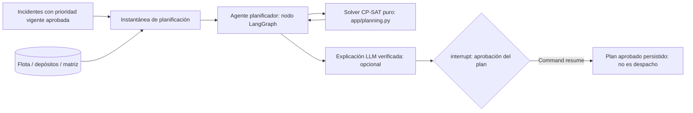

# Auditoría técnica y análisis de brechas (GAP Analysis)

Actualización 2026-10-17: este documento conserva la auditoría inicial. La corrección posterior
de explicaciones, intervalos y deduplicación está en IMPLEMENTATION.md (AG-41); Coordinación
ya no usa `explain_priority_proposal`, y el mock no confirma HIGH solo por tipo/sector.

Fecha: 2026-10-16 · Autor: Claude Code (modelo Claude Opus 5.5) a solicitud de Sebastián Feng ·
Alcance: auditoría y planificación; **no se modificó código de aplicación**, no hubo operaciones Git
de escritura, no se llamó a NVIDIA ni a GitHub. Revisión humana del equipo: pendiente.

Documentos relacionados: [ROADMAP](ROADMAP.md) · [BACKLOG](BACKLOG.md) · [NEXT_STEPS](NEXT_STEPS.md).

Convenciones de evidencia: `archivo:línea` del commit `bcd1e00`. «Observado» = comando ejecutado en
esta auditoría. «Runtime local» = lectura en modo solo-lectura de `data/runtime/*.db` (no versionado).

---

## 0. Resumen ejecutivo

1. **La fundación es sólida y sus resultados reportados son reales.** Se reprodujeron 53 pruebas backend
   (incluye las 22 evals), 6 de frontend, lint, tipos, build, `alembic check` y `npm audit` sin hallazgos.
   La cobertura real es **93 %**, no 86 %: la configuración no mide código dentro de greenlets de SQLAlchemy.
2. **El flujo implementado termina en una prioridad aprobada por reporte.** No existe prioridad por
   incidente, cola priorizada, cierre de incidentes ni ningún modelo de cisternas, flota, demanda o rutas.
   El problema central del reto (asignar agua) está **pendiente**.
3. **Tres defectos de guardrails afectan la corrección del flujo**, verificados con entradas reales:
   - la institución crítica (30 de 100 puntos y alerta inmediata) **no se detecta** cuando la frase
     contiene «no» («el hospital no tiene agua»);
   - con NVIDIA, una extracción razonable de «2 días» o de un hospital **convierte la ejecución en ERROR**
     en lugar de marcar el dato como no verificado;
   - el filtro de entrada rechaza «la pluma está seca», término común en Panamá.
4. **La inferencia real está parcialmente verificada.** GPT-OSS-20B llegó dos veces a revisión humana.
   DeepSeek V4.1 Flash agotó los tiempos. **No hay registro de una llamada real a `moonshotai/kimi-k3`**:
   la prueba documentada usó Kimi K2.6 (404). El modelo real redactó explicaciones con hechos falsos:
   leyó «26 puntos» como «26 horas».
5. **Cada reporte duplicado exige su propia aprobación humana**, con su propia puntuación final para el
   mismo incidente. Esto multiplica la carga humana y deja sin definir cuál prioridad es la vigente,
   dato que necesita el planificador de distribución.
6. **APROBAR guarda `score_min` como puntuación final.** Con datos faltantes, eso aplica en la práctica
   la penalización que la decisión D5 prohibió. En la DB local se aprobó 18 dentro de un rango de 18 a 83.
7. **La interfaz de coordinación no muestra el texto del reporte ni el nombre de la comunidad.**
   La persona revisa sin ver qué se reportó; además ve UUID, enums en inglés y JSON.
8. **Orden recomendado:**
   1. Estabilizar los guardrails y los contratos compartidos.
   2. Convertir el incidente en la unidad operativa (prioridad vigente, cola y ciclo de vida).
   3. Implementar la asignación de cisternas con OR-Tools CP-SAT y una aprobación humana del plan.
   4. Después, la supervisión por excepciones.

   La evaluación real de NVIDIA corre en paralelo. Mapas, canales y multimodal quedan como P2.

---

## 1. Fuentes inspeccionadas

| Documento solicitado | Existe | Observación |
|---|---|---|
| README.md | Sí | Preserva plantilla oficial (`git show b419b28:README.md`). `Reto: 1`. |
| AGENTS.md / CLAUDE.md | Sí | CLAUDE.md delega en AGENTS.md. Reglas aplicadas en esta auditoría. |
| CONTRIBUTING.md | Sí | GitHub Flow, DoD, etiquetas; sin protecciones remotas configuradas. |
| docs/ARCHITECTURE.md | Sí | D1–D7 aprobadas + nota de implementación (ADR 001). |
| docs/IMPLEMENTATION.md | Sí | Coincide con el código salvo matices señalados en §5. |
| docs/REQUIREMENTS.md | Sí | RF/RNF previos; FUT01 (cisternas) como P2 — esta auditoría propone elevarlo. |
| docs/ROADMAP.md / BACKLOG.md | Sí | Actualizados en esta sesión; el contenido previo se preserva en apéndices. |
| docs/AGENT_CATALOG.md | Sí | Coherente con `agents.py`. |
| docs/EVALUATION.md | Sí | Cifras reproducidas; cobertura sub-medida (§2). |
| docs/GUARDRAILS.md | Sí | Controles existen; dos tienen defectos de cobertura lingüística (§5). |
| docs/DELIVERY_CHECKLIST.md / DEMO.md | Sí | Lista de requisitos oficiales derivada; la fuente oficial completa no está en el repo. |
| docs/adr/ | Sí | Solo `001-durable-worker.md`. |
| Adicionales encontrados | — | `ARCHITECTURE.md` raíz (puntero), `docs/AI_LOG.md`, `METHODOLOGY.md`, `NVIDIA_SMOKE.md`, `REVIEW.md`. |
| Reglamento oficial del hackathon | **No** | Solo la plantilla README (`b419b28`). Los requisitos de `DELIVERY_CHECKLIST` no tienen fuente versionada. |
| GAP_ANALYSIS.md / NEXT_STEPS.md | No existían | Creados en esta sesión. |

La skill **Ponytail no está instalada en esta sesión**; no se utilizó. `docs/REVIEW.md` registra
que el agente anterior sí la consultó.

---

## 2. Verificación de resultados reportados

Entorno observado: Windows 11, Python 3.13.5, uv 0.13.0, Node 24.19.0. FastAPI 0.143.3,
LangGraph 1.2.15, langgraph-checkpoint-sqlite 3.1.2, SQLAlchemy 2.0.54, openai 2.54.0.

| Afirmación previa | Comando ejecutado en esta auditoría | Resultado observado |
|---|---|---|
| Lock válido | `uv sync --locked --check` | «Would make no changes» |
| Ruff lint/format | `uv run ruff check …` / `ruff format --check …` | Aprobado / 24 archivos formateados |
| mypy | `uv run mypy` | Sin errores en **3 archivos** (`contracts`, `domain`, `config`) |
| 53 pruebas backend, 86 % | `pytest -q -p no:cacheprovider --cov=app` | **53 passed** (21.4 s), **86 %** |
| Cobertura real | Mismo, con `concurrency = greenlet,thread` | **93 %**; `services.py` 92 % (no 55 %) |
| 22 evals | JUnit de la corrida anterior | 22 casos `test_evaluation[E01..E22]`, 0 fallos |
| 6 pruebas frontend | `npm test` | **6 passed** |
| Lint/tipos/build frontend | `npm run lint`, `typecheck`, `build` | Aprobados; JS 272.89 kB (84.51 kB gzip) |
| 0 vulnerabilidades npm | `npm audit` | **0 vulnerabilities** |
| Migraciones sin deriva | `alembic upgrade head` + `alembic check` en DB temporal | «No new upgrade operations detected» |
| Secretos fuera de Git | `git log --all -S'nvapi-'`; `git ls-files` | 0 commits con prefijo de clave; `.env` no versionado |

No ejecutado y por qué:
- `scripts/evaluate.py` reescribe `evals/results.json/xml`, que están versionados. Sus 22 casos sí
  corrieron dentro de la suite.
- `alembic upgrade`/`seed` sobre `data/runtime` no se ejecutaron para no tocar las DB de demo del equipo.
- `npm ci` habría reinstalado `node_modules`.
- CI remoto y estado de GitHub no se consultaron: son servicios externos con credenciales.

---

## 3. Cumplimiento de las decisiones aprobadas D1–D7

| Decisión | Estado | Evidencia | Desviación o brecha |
|---|---|---|---|
| D1 Monorepo | Cumple | Estructura `backend/ frontend/ evals/ data/ docs/ .github/` | Módulos huérfanos divergentes: `backend/config.py`, `backend/contracts.py`, `backend/domain/priority.py`, `backend/__init__.py`. Nadie los importa (`rg` sin resultados); usan otros nombres y umbrales. |
| D2 LangGraph HITL + saver + thread_id | Cumple con ADR 001 | `graph.py:21-64`, `worker.py:51-95`, `db.py:26-31` | La secuencia HTTP original se corrigió documentadamente (202 QUEUED + worker). Correcto. |
| D3 SQLAlchemy async + Alembic | Cumple (SQLite) | `db.py`, `migrations/` | PostgreSQL no verificado. `env.py:11` no usa `render_as_batch=True`, necesario para alterar tablas en SQLite en migraciones futuras. |
| D4 Dedupe híbrido | Cumple | `services.py:153-169`, `agents.py:45-65`, `tools.py:57-108` | Atajo determinístico por texto exacto (válido). Llama al LLM aun sin candidatos (`agents.py:63-64`). |
| D5 Motor 0–100 con intervalo | Motor cumple | `domain.py:4-55`, `tests/test_domain.py` | **Aprobar fija `score_min`** (`services.py:200-206`), lo que contradice «no restar por datos faltantes» en la decisión final. |
| D6 LLMProvider Mock + NIM | Parcial | `providers.py:50-178` | D6 exige «salidas validadas mediante Pydantic con reintentos acotados». Solo hay reintentos de transporte (`max_retries=2`). Una salida inválida produce ERROR sin reintento (`providers.py:147-150`). |
| D7 Polling + X-Coordinator-Token | Cumple | `api.ts:18-21`, `api.py:70-77`, `App.tsx:10` | Token compartido (limitación consciente). |

---

## 4. Auditoría de los agentes

### 4.1 Funcionamiento real

| Aspecto | Agente 1 — Ingesta (`agents.py:14-43`) | Agente 2 — Verificación (`agents.py:45-65`) | Agente 3 — «Coordinación» (`agents.py:67-89`) |
|---|---|---|---|
| Responsabilidad real | Clasifica tipo; extrae horas e institución crítica; concilia con el formulario; marca contradicciones | Busca candidatos (sector, 72 h, máx. 20). Texto exacto da HIGH; si no, decide el LLM. La herramienta revalida y consolida | Calcula prioridad del **reporte** con el motor puro, añade banderas, pide explicación al LLM y guarda la propuesta |
| Herramientas | `report_context`, `save_normalized`; `stated_hours`, `critical_evidence` | `association`, `candidates`, `consolidate` | `priority`, `report_context`, `save_proposal`; `calculate_priority` |
| Entrada → salida | `execution_id` → `normalized` (estado + `Report.normalized`) | `normalized` → `incident_id`, `association_status` | Estado → `priority` (estado + `Proposal`) |
| Comunicación | `WorkflowState` (`graph.py:11-18`); los agentes no se invocan entre sí | Igual | Igual |
| Decisiones autónomas | Tipo `UNKNOWN` → **NEEDS_INFORMATION terminal sin revisión humana** (`graph.py:55-58`) | LOW crea incidente; HIGH consolida sin humano | Ninguna: propone; la persona decide |
| LLM real vs mock | `extract_report`; horas y crítico son vetados o sobrescritos por regex | `evaluate_duplicate`. El mock consolida HIGH cualquier par del mismo tipo y sector | `explain_priority_proposal` (solo texto) |
| Guardrails | Fundamentación de horas/crítico, rangos, contradicción | UUID ∈ candidatos, tipo compatible, sector, ventana (`tools.py:64-72`) | La puntuación nunca viene del LLM |
| Limitaciones | D-01, D-02, D-18; un falso `UNKNOWN` descarta el reporte sin que lo vea una persona | D-05; el resumen del incidente es el texto del primer reporte; envía texto ciudadano ajeno al LLM | D-04, D-08, D-09; «coordinación» no coordina recursos |
| Pruebas | E01–E04, E09–E12, E21; replay | E05–E07, E18, E20, E22; `test_tool_revalidates_…` | E08, E13–E19; `test_domain.py` |

### 4.2 Acoplamientos

- `stated_hours` y `critical_evidence` son **reglas de dominio** pero viven en `providers.py:35-47`.
  AGENTS.md limita `providers.py` a Mock/NIM. Recomendación: moverlas a un módulo puro
  (`app/grounding.py`) al corregir D-01/D-02; no hace falta un agente nuevo.
- La lógica de conciliación del Agente 1 (`agents.py:20-42`) mezcla LLM y reglas. Debe ser una función
  pura con tabla de casos.
- `human_review` y `finalize` están bien separados. `traced` (`graph.py:36-45`) duplica eventos START/END
  en replay (documentado).
- El nombre «Coordinación» induce a error: el agente **prioriza**. Conviene renombrarlo en la UI y la
  documentación a «Priorización» y reservar «coordinación» para el planificador.

### 4.3 Agentes futuros — recomendación

| Capacidad | ¿Agente LLM? | Recomendación | Cuándo |
|---|---|---|---|
| Planificador de distribución | Sí, con límites. El **solver decide** (puro, como el motor); el agente reúne contexto, invoca la herramienta, explica infactibilidad y propone. | Grafo LangGraph **separado por corrida de planificación** (no por reporte), mismo worker y checkpointer, con su propio HITL | **Primero** (Fase 3) |
| Supervisión y auditoría | **No.** Servicio de reglas determinístico y versionado, más un nodo `triage` | Ver §8. Un LLM supervisor añade no determinismo donde más se necesita auditar | Fase 4 |
| Comunicación | Parcial: plantillas determinísticas y paráfrasis LLM opcional con verificación de hechos | Solo después de que exista un plan aprobado que comunicar | Fase 5 |
| Geolocalización | No hasta tener datos verificados | Sin geodatos autorizados, un agente que «ubica» texto inventaría coordenadas. Usar matriz de tiempos manual con procedencia | Fase 5, condicionada a datos |
| Multimodal (audio, imagen) | Sí, en el futuro | Requiere política de consentimiento, PII (voces, rostros), almacenamiento y evaluación | Último (P2) |

---

## 5. Defectos y hallazgos verificados

Reproducción de D-01 a D-03: script de sondeo con las funciones reales (`critical_evidence`,
`stated_hours`, `ReportInput`, `MockLLMProvider.extract_report`) en esta auditoría.

| ID | Hallazgo | Evidencia | Impacto | P |
|---|---|---|---|---|
| D-01 | La negación `\b(no\|sin afectar\|ningun)\b` anula la detección de institución crítica en frases comunes. «En el hospital no hay agua», «La escuela no tiene agua», «El centro de salud no recibe agua» y «No llega el agua a la policlínica» devuelven `None`; solo «Hospital sin agua…» devuelve `True`. | `providers.py:46` | Pierde 30 puntos y `immediate_review`. **Con NIM**, si el modelo responde correctamente `True`, `agents.py:27-28` lanza `UNGROUNDED_CRITICAL_INSTITUTION` y la ejecución queda en ERROR. | **P0** |
| D-02 | La fundamentación de horas solo reconoce «N hora(s)». «2 días», «desde ayer», «24h» y «una semana» devuelven `[]`; «1 hora y media» devuelve `[1.0]`. | `providers.py:35-39`, `agents.py:20-25` | Con NIM, extraer 48 de «2 días» produce ERROR, y el reintento es determinístico (falla igual). La ejecución nunca llega a una persona. | **P0** con NIM |
| D-03 | El filtro temático exige `agua\|acueducto\|tuberia\|grifo\|suministro`. Se rechazan con 422 «La pluma está seca desde ayer», «Llevamos 3 días sin servicio» y «No ha pasado el carro cisterna en 3 días». | `contracts.py:56` | Falsos negativos en la puerta ciudadana, con vocabulario panameño. | P1 |
| D-04 | La explicación real tergiversa el motor. Con GPT-OSS-20B: «Horas: 26 horas de duración» cuando 26 eran **puntos** de 35, y «el evento se registró a las 9 h» por un factor `[9, 9]`. | Runtime local `aguaia-nvidia.db` (ejecuciones `f27c37a6`, `f2c78ad0`). Causa: se envían factores sin etiquetas ni unidades (`agents.py:86-88`, `providers.py:168-174`) | El texto que lee el coordinador contiene hechos falsos | P1 |
| D-05 | Se llama al LLM de deduplicación aunque no haya candidatos. | `agents.py:63-64`; runtime local: verificación de 4.9 s con 0 candidatos | Latencia, costo y riesgo de que el modelo invente un UUID (que la herramienta rechaza con ERROR) | P1 |
| D-06 | El worker guarda solo el nombre de la clase de excepción (`ProviderError`) y pierde códigos controlados como `UNGROUNDED_HOURS`. | `worker.py:89`, `CoordinationPage.tsx:80` | El coordinador ve «ProviderError»; diagnosticar y evaluar se vuelve difícil | P1 |
| D-07 | El detalle de coordinación no incluye texto del reporte, comunidad, distrito ni resumen del incidente. | `services.py:230-249`; `types.ts:22-28` | La revisión humana se hace sin ver la evidencia: HITL poco significativo | **P0** |
| D-08 | APROBAR guarda `score_min`; la UI dice «Aprobar límite inferior». | `services.py:200-206`, `CoordinationPage.tsx:23`, `test_process_e2e.py` (aserción `final_score == score_min`). Runtime local: aprobado 18 en un rango 18–83 | Contradice D5 y sesga contra sectores sin censo. El planificador heredaría el sesgo | **P0** (decisión) |
| D-09 | Cada reporte duplicado crea propuesta y revisión propias; el incidente no tiene prioridad vigente. | `agents.py:67-89`, E05/E06: el 2.º reporte queda `WAITING_APPROVAL` con la misma prioridad | La carga humana crece con los reportes; varias `final_score` contradictorias por incidente; no hay entrada para planificar | **P0** |
| D-10 | El incidente solo tiene los estados OPEN y PRIORITIZED: no se atiende, resuelve ni cierra. | `models.py:54`, `services.py:159, 207-210` | Un incidente resuelto sigue absorbiendo duplicados 72 h; no se puede cerrar el ciclo de distribución | P1 |
| D-11 | No hay cola priorizada: los listados se ordenan por fecha o actividad. | `api.py:137, 152` | La salida principal (prioridades) no se presenta como orden de atención | **P0** |
| D-12 | La cobertura no considera greenlets (86 % reportado contra 93 % real). | `pyproject.toml [tool.coverage.run]` | Métrica engañosa por archivo | P2 |
| D-13 | Módulos huérfanos divergentes (ver D1). | `backend/config.py`, `backend/contracts.py`, `backend/domain/priority.py` | Confusión para tres personas nuevas en el repo | P1 |
| D-14 | Una sola paginación compartida para ejecuciones e incidentes. | `CoordinationPage.tsx:105-131` | Avanzar una lista mueve la otra | P2 |
| D-15 | `env_file="../.env"` y las rutas SQLite dependen del directorio actual. | `config.py:9` | Desde la raíz, `.env` se ignora sin aviso y se usan los valores por defecto | P2 |
| D-16 | `app = create_app()` al importar crea directorios y un engine. | `api.py:184` | Efecto secundario al importar (tests, herramientas) | P2 |
| D-17 | El ciudadano recibe un UUID «para consultar», pero no hay vista de consulta. | `CitizenPage.tsx:45-46` | Promesa sin funcionalidad | P2 |
| D-18 | Taxonomía y mock: no existen tipos para calidad del agua (turbia) ni suministro intermitente. El mock clasifica «Hace dos días no sale agua de la pluma» como `UNKNOWN`, que termina sin revisión. | `contracts.py:63`, `providers.py:57-76` | Reportes válidos terminan en NEEDS_INFORMATION | P1 |
| D-19 | El evento `PROPOSED` se registra con `tool="calculate_priority"` aunque persiste `save_proposal`. | `tools.py:127-135` | Trazabilidad imprecisa | P2 |
| D-20 | Resultados de evals versionados con timestamp. | `evals/results.json`; `scripts/evaluate.py` los reescribe | Conflictos de merge seguros con tres personas | P1 |
| D-21 | Los listados admin (200), `health` y `communities` no se prueban en proceso. | Cobertura: `api.py:89-91, 99-100, 131-132, 146-147` | Contratos sin red de seguridad | P2 |
| D-22 | Documentación inconsistente: Kimi K3 no probado (se probó K2.6); segunda ejecución NIM no registrada; cobertura. | `NVIDIA_SMOKE.md`, `README.md`, `EVALUATION.md` | Afirmaciones imprecisas ante el jurado | P1 |
| D-23 | El historial oficial es un único commit masivo (`a0c60bd`). | `git log` | Riesgo ante un criterio de «historial de commits» (no verificable sin el reglamento) | P1 |
| D-24 | CI se dispara en `push` y en `pull_request`. | `ci.yml:2-4` | Ejecuciones duplicadas en ramas con PR | P2 |

---

## 6. NVIDIA: auditoría del adaptador y evaluación real

### 6.1 Adaptador `NvidiaLLMProvider` (`providers.py:111-174`)

| Aspecto | Estado | Detalle |
|---|---|---|
| Configuración | Bien | `Settings`: `nvidia_api_key` (SecretStr), `nvidia_model`, `nvidia_base_url`, `llm_timeout_seconds` (≤ 60) |
| Credenciales | Bien | Clave solo en backend; error al arrancar sin clave; mensajes upstream descartados (`providers.py:148-150`); 0 commits con clave |
| Modelos configurables | Parcial | Un modelo para las tres tareas; no hay modelo por tarea |
| Validación Pydantic | Bien | `model_validate_json`, contratos `extra="forbid"` |
| Structured outputs | Débil | Esquema en el prompt; `response_format` retirado por timeouts. No hay extracción tolerante: JSON entre bloques de código markdown o con preámbulo falla. `max_tokens=1800` puede truncar a modelos con razonamiento |
| Errores | Parcial | Todo se convierte en `ProviderError(<clase>)` y el worker solo guarda «ProviderError» (D-06) |
| Timeouts y reintentos | Parcial | Timeout configurable; 2 reintentos de transporte; **sin reintento por salida inválida (desviación D6)** |
| Trazabilidad | Débil | No se registran latencia por llamada, intento, `finish_reason`, `usage` ni resultado de validación |
| Separación simulación/real | **Muy bien** | `provider` e `is_simulated` por ejecución; el worker rechaza cambios de proveedor (`worker.py:69-70`); banner en la UI |

Latencia observada (runtime local, GPT-OSS-20B, 2 ejecuciones, timeout de 30 s):

| Agente | Ejecución f27c37a6 | Ejecución f2c78ad0 |
|---|---|---|
| Ingesta | 5.6 s | 4.5 s |
| Verificación | 4.9 s (0 candidatos) | 41.3 s (1 candidato) |
| Coordinación | 9.4 s | 20.3 s |
| **Total** | **20 s** | **66 s** |

Peor caso teórico con la configuración actual: 3 llamadas × 3 intentos × 30 s ≈ 4.5 min por ejecución,
en un worker secuencial (bloqueo en cabeza de cola).

Divergencia con el mock, verificada en datos reales: GPT-OSS-20B evaluó LOW un par del mismo sector y tipo
porque las duraciones reportadas eran distintas (10 h contra 24 h). El mock lo habría consolidado HIGH.
Las 22 evals sobre el mock **no predicen** el comportamiento real.

### 6.2 Evaluación propuesta para DeepSeek V4.1 Flash y Kimi K3

**Requisito previo:** autorización explícita de cuota. Ninguna llamada se hace desde CI.

1. **Sondeo de disponibilidad.** Una petición mínima por modelo, sin datos ciudadanos, registrando latencia,
   código HTTP y si el modelo devuelve razonamiento separado o mezclado en `content`.
   Confirmar `moonshotai/kimi-k3` **antes** de invertir en él.
2. **Corpus anotado por personas** (sintético, `evals/llm/`):
   - extracción: ≥ 40 textos con variantes panameñas («pluma», «IDAAN», «desde ayer», «2 días»,
     negaciones, hospitales, escuelas);
   - deduplicación: ≥ 30 pares misma, distinta o ambigua;
   - explicación: ≥ 15 resultados de prioridad.

   Dos personas anotan; se registra el acuerdo entre anotadores.
3. **Métricas comparables** (misma plantilla, temperatura 0, 3 repeticiones):

| Tarea | Métrica principal | Secundarias |
|---|---|---|
| Extracción | **Recall de institución crítica** (omitir un hospital es lo más grave) | Exactitud/macro-F1 de tipo, exactitud de horas, % de violaciones de fundamentación |
| Deduplicación | **Tasa de fusión falsa** (fusionar distintos) | Precisión/recall de «misma», % MEDIUM (deferencia), % UUID inválido |
| Explicación | **Fidelidad numérica automática**: todo número citado ∈ factores; sin términos prohibidos («despachó») | Rúbrica humana 1–5 de claridad (2 evaluadores) |
| Operación | % de salidas válidas al esquema | p50/p95 de latencia, % timeout, tokens (`usage`), estabilidad entre repeticiones |

4. **Harness** `scripts/evaluate_llm.py`:
   - modo `offline` por defecto; `--live` exige `AGUAIA_ALLOW_LIVE_LLM=1`;
   - resultados en `evals/llm/<modelo>-<fecha>.json`, separados de las evals mock;
   - línea base: mock y GPT-OSS-20B.
5. **Antes de evaluar**, corregir D-01, D-02, D-04, D-05 y D6. Si no, la evaluación mediría defectos
   del adaptador y no la calidad del modelo.
6. **Experimentos a verificar, no a suponer:** soporte de salida estructurada por modelo en el catálogo
   NVIDIA (`response_format` con `json_schema`, o parámetros guiados propios de NIM) y forma de
   desactivar el modo de razonamiento si el modelo lo expone. Consultar la ficha del modelo en
   build.nvidia.com.

---

## 7. Distribución de agua mediante carros cisterna

### 7.1 Requisitos y disponibilidad de datos

| Requisito | Demostrable con datos sintéticos | Requiere información verificable |
|---|---|---|
| Registro de cisternas (id, capacidad L, depósito base, estado) | Sí, marcado `is_synthetic` | Flota real (IDAAN, municipio o contratistas) |
| Disponibilidad y horario (turno inicio–fin) | Sí | Turnos reales |
| Ubicación inicial | Como **depósito o punto de llenado nombrado**, sin coordenadas | Coordenadas o dirección oficial |
| Demanda por comunidad | Sí: `población × L/persona/día × días` con política versionada. Referencia a validar: la norma humanitaria Esfera cita ≥ 15 L/persona/día (no es norma panameña) | Población (censo INEC) y consumo local |
| Capacidad de suministro | Sí: litros por día por depósito | Capacidad real de plantas o pozos |
| Combustible | Proxy: minutos o km máximos por turno | Autonomía y consumo reales |
| Distancias y tiempos | **Matriz manual depósito→comunidad en minutos, con `source` = SYNTHETIC/MANUAL/VERIFIED** | Motor de rutas sobre geodatos con licencia (OSRM/OSM, por ejemplo) |
| Ventanas de tiempo | Turno de la cisterna y ventana de recepción por comunidad | Ventanas reales de acceso |
| Asignación de comunidades | Sí (Fase 3a) | — |
| Rutas multiparada | Solo con matriz completa entre comunidades | Matriz verificada (Fase 3b, P2) |
| Aprobación del plan | Sí: HITL nuevo | Autoridad real que aprueba |

**No se inventan coordenadas, tiempos de conducción ni capacidades reales.** Todo dato de flota,
depósito o matriz lleva procedencia, y la UI la muestra.

### 7.2 Formulación recomendada (Fase 3a — asignación por viajes, OR-Tools CP-SAT)

Un viaje = depósito → comunidad → depósito (patrón habitual de cisterna). No requiere distancias
entre comunidades.

Conjuntos y parámetros:
- **Conjuntos:** cisternas `T`, comunidades con demanda `C`, depósitos `D`.
- **Parámetros:**
  - `cap_t`: litros por cisterna;
  - `turno_t`: minutos disponibles;
  - `base(t)`: depósito de origen;
  - `oferta_d`: litros por día del depósito;
  - `ida_{d,c}`: minutos depósito → comunidad;
  - `servicio_c`: minutos de descarga;
  - `dem_c`: litros demandados;
  - `w_c`: prioridad vigente aprobada del incidente de la comunidad (requiere AG-14);
  - `min_c`: mínimo para comunidades con `immediate_review` (política).

Variables:
- `x_{t,c}` ∈ ℤ≥0: viajes de la cisterna `t` a la comunidad `c`;
- `y_c` ∈ [0, dem_c]: litros contabilizados como entregados.

Restricciones:
- `Σ_c x_{t,c}·(2·ida_{base(t),c} + servicio_c) ≤ turno_t`: tiempo y combustible proxy;
- `y_c ≤ Σ_t x_{t,c}·cap_t`;
- `Σ_{t: base(t)=d} Σ_c x_{t,c}·cap_t ≤ oferta_d`;
- `y_c ≥ min_c` para críticas. Si no es factible, el resultado es INFEASIBLE con diagnóstico
  determinístico.

Objetivo lexicográfico:
1. maximizar `Σ w_c·y_c`;
2. minimizar minutos totales;
3. desempate por id.

Reproducibilidad: `num_workers=1`, `random_seed` fijo, `max_time_in_seconds` acotado.

La **escasez no es infactibilidad**: el plan reporta la demanda no cubierta por comunidad.

Salida del plan:
- viajes por cisterna (comunidad, litros, minutos estimados);
- cobertura por comunidad y demanda no cubierta;
- indicadores (cobertura ponderada, minutos);
- `solver_status`, `policy_version`, hash de la instantánea de entradas y banderas de datos sintéticos.

**Fase 3b (P2): rutas CVRPTW** con la librería de routing de OR-Tools (`RoutingModel`, dimensión de
capacidad y dimensión de tiempo con ventanas). Requiere la matriz completa verificada.

### 7.3 Integración sin reescribir la arquitectura

- **Datos:** tablas `depots`, `tankers`, `travel_times` (con `source`), `plan_runs` (estado de cola
  idéntico al de `executions`), `plan_reviews` y `plan_trips`. Requieren migración con batch mode (AG-07).
- **Dominio puro:** `app/planning.py` (OR-Tools) y `DistributionPolicyConfig` versionada, en el mismo
  patrón que `domain.py`.
- **Grafo:** `build_planning_graph` con `thread_id = plan_run.id`. Mismo checkpointer y mismo worker:
  `process_one` atiende reportes y luego planes, bajo el mismo lock. La API responde 202 y nunca ejecuta
  el solver (ADR 001).
- **API protegida:** `/api/admin/fleet`, `/depots`, `/travel-times`, `POST /api/admin/plans` (202),
  `GET /api/admin/plans/{id}`, `POST /api/admin/plans/{id}/review`.
- **Dependencia nueva:** `ortools`. Verificar wheels para Python 3.13 en Windows y Linux (matriz CI)
  antes de fijarla en `uv.lock`.

---

## 8. Supervisión humana por excepciones (propuesta; no implementar todavía)

### 8.1 Arquitectura

No se propone un agente LLM supervisor. Se propone un **servicio de reglas puro y versionado**,
`route_review(propuesta, asociación, banderas, historial_incidente, política) → {ruta, códigos}`,
invocado por un nodo `triage` entre `coordination` y `human_review`:

- la ruta **HUMANO** conserva el `interrupt()` actual;
- la ruta **AUTO** va a `finalize_auto`, que guarda un `Review` con `actor="policy:review-v1.0.0"`,
  los códigos de razón y la versión de política.

Modo `REVIEW_MODE=all_human|exceptions`, por defecto `all_human` (comportamiento actual), registrado
por ejecución.

### 8.2 Política determinística

| Código | Regla (cualquiera → HUMANO) | Fuente del dato |
|---|---|---|
| R1 INSTITUCION_CRITICA | `immediate_review` o mención de institución no verificada | Motor + fundamentación |
| R2 ASOCIACION_TENTATIVA | `association_status = PENDING_REVIEW` | Herramienta |
| R3 DATOS_CONTRADICTORIOS | Banderas `CONTRADICCION_*`, `*_FUERA_DE_RANGO`, `*_NO_VERIFICADA` | Ingesta |
| R4 INCERTIDUMBRE_ALTA | `confidence_level = LOW` o `score_max − score_min > W` | Motor |
| R5 PRIORIDAD_ALTA | `score_max ≥ H` | Motor |
| R6 POSIBLE_DUPLICADO | LOW, pero existe un incidente abierto del mismo sector y tipo | SQL |
| R7 ESCALAMIENTO | Reporte que eleva `score_min` sobre la prioridad vigente + Δ, o añade institución crítica | Motor + historial |
| R8 MODELO_NO_EVALUADO | El proveedor real no está en la lista de modelos que superaron los umbrales de §6.2 | Configuración |
| R9 REINTENTO | `attempts > 1` o recuperado de ERROR | Worker |
| R10 MUESTREO | `hash(execution_id) mod 100 < S` (auditoría aleatoria reproducible) | Determinístico |
| R11 RECURSOS | Todo plan de distribución | Siempre humano |

AUTO solo se permite en dos casos, si ninguna regla aplica:

- **(a) evidencia adjunta:** el reporte se consolidó con HIGH en un incidente con prioridad vigente
  aprobada por una persona y sin escalamiento; no se crea una prioridad nueva;
- **(b) registro de baja prioridad:** confianza HIGH y `score_max < L`.

`W`, `H`, `L`, `Δ` y `S` son parámetros de política, no constantes en el código.

### 8.3 Riesgos y cumplimiento de HITL

| Riesgo | Mitigación |
|---|---|
| Consolidación falsa aceptada automáticamente | AUTO (a) solo hacia un incidente ya aprobado por una persona y sin escalamiento; R6 y R10 |
| El LLM «decide» indirectamente vía `match_confidence` | R8 exige un modelo evaluado; la herramienta revalida sector y tipo; la ruta se calcula con datos determinísticos |
| Percepción de incumplimiento de HITL | Las decisiones de impacto (crítico, incertidumbre, recursos) siguen siendo humanas. Toda decisión AUTO es visible, auditable y **reversible**. Modo `all_human` disponible para la demo |
| Cambio de topología con hilos pausados | Drenar la cola o probar la reanudación de checkpoints previos antes del despliegue (METHODOLOGY) |

Pruebas necesarias:
- tabla de casos por regla (positiva y negativa);
- evals E23+ para ambas rutas;
- idempotencia y replay de `finalize_auto`;
- reversión;
- determinismo del muestreo;
- `all_human` intacto: las 22 evals actuales deben pasar sin cambios;
- hilo pausado antes del despliegue que reanuda correctamente.

---

## 9. Frontend y experiencia de usuario

### 9.1 Evaluación

| Criterio | Estado | Evidencia |
|---|---|---|
| Comprensibilidad | Baja para no técnicos | UUID (`CoordinationPage.tsx:63, 125, 139`); enums en inglés (`OUTAGE`, `PENDING_REVIEW`, `MEDIUM`: líneas 74, 76, 139); slug `arraijan-demo`; `v1.0.0-demo`; JSON de trazas (97) |
| Flujo ciudadano | Bueno y simple | Validación, idempotencia, estados en español. UUID sin consulta posterior (D-17) |
| Centro de coordinación | Insuficiente para decidir | Sin texto del reporte ni comunidad (D-07); lista por fecha, sin cola priorizada (D-11); paginación acoplada (D-14) |
| Prioridades | Técnica | «45–75 / 100», «Confianza de datos: MEDIUM» sin explicar qué falta ni por qué |
| Aprobación y corrección | Confusa | «Aprobar límite inferior» (D-08); sin confirmación; resolución de asociación sin mostrar el incidente candidato |
| Trazabilidad | Para desarrolladores | Línea de tiempo con agente, evento, herramienta y JSON |
| Carga y error | Presente | `role=status`, `role=alert`; errores crudos («ProviderError») |
| Responsive | Básico | Un breakpoint a 800 px; sin prueba en dispositivo |
| Accesibilidad | Base correcta, sin auditar | Etiquetas envolventes, `aria-live`, `focus-visible`. Faltan `aria-current` en la navegación y foco tras enviar. Textos de 10–11 px (banderas, insignias). Sin auditoría con lector ni axe |
| Pruebas | 6, en un solo archivo | Sin casos de NEEDS_INFORMATION, ERROR + reintento, ni asociación tentativa en la UI |

### 9.2 Tres niveles de información

| Audiencia | Debe ver | No debe ver |
|---|---|---|
| Ciudadanía (pública) | Código corto de reporte; estado en lenguaje llano (Recibido, En análisis, En revisión, Registrado, Necesita más información); qué hacer después; aviso de que no es un despacho | Puntuación, otros reportes, proveedor, trazas |
| Coordinación (operativa) | Cola de incidentes ordenada por urgencia: comunidad, distrito, tipo en español, horas, nº de reportes, prioridad vigente con banda (Alta/Media/Baja) y rango explicado («falta: población del sector»), alertas. Texto del reporte, incidente candidato, decisión con confirmación y línea de tiempo legible | UUID, enums, JSON, nombre del proveedor salvo el modo real/simulado |
| Desarrollo (técnica) | Panel plegable «Detalles técnicos»: IDs, proveedor y modelo, intentos, códigos de error, trazas JSON, versión de política | — |

---

## 10. Calidad, seguridad y mantenibilidad

| Tema | Estado | Nota |
|---|---|---|
| Arquitectura modular | Bien | Límites de AGENTS.md respetados en `app/`; excepciones: D-13 y reglas en `providers.py` |
| Contratos de API | Parcial | `response_model` solo en recibo, reporte y resume. Listados y detalle admin sin esquema, por lo que OpenAPI no los describe y `types.ts` se mantiene a mano (riesgo de deriva) |
| Migraciones | Bien hoy, riesgo mañana | Inicial reversible, `alembic check` limpio. Falta `render_as_batch` (SQLite) y la regla de **un solo head** al trabajar en paralelo |
| Idempotencia | Muy bien | `Idempotency-Key`, CAS de revisión, `applied_at`, herramientas idempotentes, replay probado |
| Cola durable y recuperación | Muy bien | Lock del SO, `recover`, prueba e2e con procesos reales |
| Concurrencia | Adecuada al MVP | Un worker secuencial; WAL y `busy_timeout`. Bloqueo en cabeza de cola con NIM (§6.1) |
| Autorización | MVP consciente | Token compartido con `compare_digest` (mínimo 16). Sin identidad individual: crítico antes de aprobar **planes de recursos** reales |
| Endpoints | Bien | Admin protegido; público mínimo; 413/429/409/422 |
| Validación | Bien con falsos negativos | D-03, D-18 |
| Secretos | Bien | Verificado en el historial |
| Guardrails | Parcial | D-01, D-02, D-04 |
| Trazabilidad | Bien en negocio | Faltan métricas de llamadas LLM; D-19 |
| Pruebas | Buenas | Huecos: D-21, frontend, navegador real |
| Cobertura | Sub-medida | D-12 |
| Dependencias | Bien | Locks; npm audit 0; no se ejecutó auditoría de Python (`pip-audit` no está en el lock) |
| CI | Definido, remoto no verificado | Matriz Windows/Linux; D-24; resultados versionados (D-20) |
| Documentación | Abundante | Inconsistencias D-22. La bitácora IA no registra todavía cambios manuales del equipo (requisito oficial: «qué se modificó a mano») |

---

## 11. Matriz GAP

Estados:
- **IV**: implementado y verificado;
- **IP**: implementado parcialmente;
- **INV**: implementado pero no verificado;
- **SIM**: simulado;
- **PEN**: pendiente;
- **NA**: no aplicable.

Esfuerzo: XS ≤ 2 h · S ≈ medio día · M ≈ 1 día · L ≈ 2–3 días. Las tareas correspondientes están
en [BACKLOG](BACKLOG.md).

### 11.1 Requisitos oficiales (plantilla README + DELIVERY_CHECKLIST)

| ID | Requisito | Estado | Evidencia | Brecha | Impacto | P | Dep. | Esf. | Pruebas necesarias | Recomendación |
|---|---|---|---|---|---|---|---|---|---|---|
| OF-01 | ≥ 3 agentes comunicados | IV (mock) / IP (real) | `graph.py:47-63`, evals | Solo verificado con mock en evals | Medio | P1 | AG-27 | — | Evals reales | Evaluación NIM (Fase 2) |
| OF-02 | Herramienta con acción real | IV | `tools.py`, `services.py` | La acción es persistencia interna; la acción de dominio (plan) falta | Medio | P0 | AG-29+ | — | Evals de plan | El plan aprobado será la acción más visible |
| OF-03 | Componente determinístico | IV | `domain.py`, `test_domain.py` | — | — | — | — | — | — | Mantener |
| OF-04 | Humano en el ciclo | IV | `graph.py:27-29`, E14–E19 | Revisión sin ver evidencia (D-07) | Alto | P0 | AG-13 | S | UI + API | AG-13, AG-18 |
| OF-05 | Trazabilidad | IV | `Trace`, UI | Ilegible para no técnicos; sin métricas LLM | Medio | P1 | — | M | UI | AG-19, AG-23 |
| OF-06 | ≥ 15 evals con métrica | IV (mock) | 22/22 | Ninguna eval mide modelo real | Medio | P1 | AG-25 | M | Corpus anotado | AG-25–27 |
| OF-07 | Guardrails | IP | GUARDRAILS + tests | D-01, D-02, D-03 | Alto | P0 | — | S | Tablas lingüísticas | AG-01, AG-02, AG-05 |
| OF-08 | README oficial completo | IV | README.md | Desactualizado tras los cambios | Bajo | P1 | — | XS | Revisión | AG-12 |
| OF-09 | Credenciales demo sin claves | IV | `.env.example` | — | — | — | — | — | — | Mantener |
| OF-10 | Diagrama de arquitectura | IV | README, IMPLEMENTATION | Actualizar con el planificador | Bajo | P1 | AG-33 | XS | — | Al cerrar Fase 3 |
| OF-11 | Bitácora IA | IP | AI_LOG.md | Falta «qué se modificó a mano» por el equipo | Medio | P0 | — | XS por PR | Revisión | Entrada por PR |
| OF-12 | Tag `final-24h` | PEN | `git tag` vacío | — | Crítico | P0 | Todo | XS | — | Solo al congelamiento autorizado |
| OF-13 | Video ≤ 3 min | PEN | DEMO.md | No grabado | Crítico | P0 | Demo estable | S | Ensayo | AG-49 |
| OF-14 | Historial de commits | IP | 5 commits, uno masivo | D-23 | Medio | P1 | — | — | — | PR pequeños desde ahora; no reescribir historial |
| OF-15 | Registro al inicio del periodo | INV | — | No verificable en el repo | ? | P0 | — | — | — | Confirmar con organizadores |

### 11.2 Funcionalidades del dominio

| ID | Funcionalidad | Estado | Evidencia | Brecha | Impacto | P | Dep. | Esf. | Pruebas necesarias | Recomendación |
|---|---|---|---|---|---|---|---|---|---|---|
| FN-01 | Registrar reporte ciudadano | IV | `api.py:105-119`, E01, E17 | — | — | — | — | — | — | Mantener |
| FN-02 | Normalización | IP | `agents.py:14-43` | D-01, D-02, D-18 | Alto | P0 | — | S | Tabla ≥ 20 frases | AG-01, AG-02, AG-05 |
| FN-03 | Deduplicación y consolidación | IV (mock) / INV (real) | E05–E07, E18, E20, E22 | D-05; divergencia real | Medio | P1 | AG-25 | S | Pares anotados | AG-03, AG-27 |
| FN-04 | Prioridad determinística | IV | `domain.py` | — | — | — | — | — | — | Mantener |
| FN-05 | Prioridad vigente por incidente | PEN | — | D-09 | Crítico | P0 | AG-14 | M | Agregación, replay | AG-14, AG-16 |
| FN-06 | Revisión humana de propuesta | IP | E14–E19 | D-07, D-08 | Alto | P0 | AG-13, AG-15 | M | UI + API | AG-13, AG-15, AG-19 |
| FN-07 | Ciclo de vida del incidente | PEN | `models.py:54` | D-10 | Alto | P1 | AG-14 | S | Transiciones | AG-17 |
| FN-08 | Cola priorizada de atención | PEN | `api.py:137,152` | D-11 | Crítico | P0 | AG-14 | M | Orden y desempate | AG-16, AG-18 |
| FN-09 | Registro de cisternas | PEN | — | Sin modelo | Crítico | P0 | AG-29 | M | CRUD + validación | AG-30 |
| FN-10 | Depósitos y oferta | PEN | — | Sin modelo | Alto | P0 | AG-29 | S | CRUD | AG-30 |
| FN-11 | Demanda por comunidad | PEN | — | Sin política | Alto | P0 | AG-29 | S | Unitarias | AG-31 |
| FN-12 | Matriz de tiempos con procedencia | PEN | — | Sin datos | Alto | P0 | AG-29 | S | Validación | AG-30 |
| FN-13 | Plan de asignación (CP-SAT) | PEN | — | Sin solver | Crítico | P0 | AG-30, AG-31 | L | Casos calculables a mano, determinismo | AG-32 |
| FN-14 | HITL del plan | PEN | — | — | Crítico | P0 | AG-32 | L | Replay, CAS | AG-33, AG-34 |
| FN-15 | Rutas multiparada con ventanas | PEN | — | Requiere matriz verificada | Medio | P2 | AG-32 | L | CVRPTW | AG-37 |
| FN-16 | Seguimiento de entregas | PEN | — | — | Medio | P2 | AG-33 | M | Estados | AG-38 |
| FN-17 | Supervisión por excepciones | PEN | — | §8 | Alto | P1 | AG-14, AG-27 | M | §8.3 | AG-39 a AG-42 |
| FN-18 | Consulta ciudadana | IP | `api.py:121-127` | Sin UI (D-17) | Bajo | P2 | — | S | UI | AG-20 |
| FN-19 | Comunicación ciudadana | PEN | — | — | Medio | P2 | AG-33 | M | Fidelidad de hechos | AG-44 |
| FN-20 | Mapa y geolocalización | PEN | — | Sin geodatos | Medio | P2 | Datos | L | — | AG-43 |
| FN-21 | Multimodal | PEN | — | Política PII | Bajo | P2 | AG-47 | L | — | AG-46 |
| FN-22 | Canales externos | PEN | — | Autorización | Bajo | P2 | AG-47 | L | — | AG-45 |
| FN-23 | Catálogo de sectores real | SIM | `data/communities.json` | Sintético | Alto (real) | P1 | Fuente oficial | M | Procedencia | AG-48 |

### 11.3 IA y NVIDIA

| ID | Requisito | Estado | Evidencia | Brecha | Impacto | P | Dep. | Esf. | Pruebas necesarias | Recomendación |
|---|---|---|---|---|---|---|---|---|---|---|
| AI-01 | Mock determinístico | IV | `providers.py:50-105` | Taxonomía (D-18) | Bajo | P1 | — | XS | — | AG-05 |
| AI-02 | Adaptador NIM (contrato offline) | IV | `test_provider.py` | — | — | — | — | — | — | Mantener |
| AI-03 | Inferencia real de punta a punta | IP | Runtime local: 2 ejecuciones GPT-OSS-20B | Sin revisión completada ni evals | Medio | P1 | AG-26 | S | Flujo real con revisión | AG-27 |
| AI-04 | DeepSeek V4.1 Flash | PEN | NVIDIA_SMOKE: timeouts | No operativo | Medio | P1 | AG-24 | S | Sondeo + evals | AG-27 |
| AI-05 | Kimi K3 | PEN | Sin registro (se probó K2.6) | Nunca invocado | Medio | P1 | AG-24 | S | Sondeo + evals | AG-27 |
| AI-06 | Reintento por salida inválida (D6) | PEN | `providers.py:147-150` | Desviación D6 | Medio | P1 | — | S | Transporte simulado | AG-24 |
| AI-07 | Telemetría por llamada | PEN | — | — | Medio | P1 | — | S | Sin contenido sensible | AG-23 |
| AI-08 | Explicación fiel | IP | D-04 | Hechos falsos | Alto | P1 | — | S | Verificador numérico | AG-21 |
| AI-09 | Evals con modelo real | PEN | — | — | Alto | P1 | AG-25, AG-26 | M | §6.2 | AG-25 a AG-27 |

### 11.4 Calidad y seguridad

| ID | Requisito | Estado | Evidencia | Brecha | Impacto | P | Dep. | Esf. | Pruebas necesarias | Recomendación |
|---|---|---|---|---|---|---|---|---|---|---|
| QS-01 | Cola durable y recuperación | IV | `test_resilience.py`, `test_process_e2e.py` | Planes aún no incluidos | — | P0 | AG-33 | — | Extender al planificador | Reutilizar patrón |
| QS-02 | Idempotencia | IV | E17, replay | — | — | — | — | — | — | Mantener |
| QS-03 | Identidad de coordinadores | IP | Token compartido | Sin auditoría individual | Alto en real | P1 | — | M | Roles | AG-47 |
| QS-04 | Rate limit | IV | `test_rate_limit_persisted` | Detrás del proxy, un solo bucket | Bajo | P2 | — | — | — | Documentar |
| QS-05 | Secretos | IV | Historial limpio | — | — | — | — | — | — | Mantener |
| QS-06 | Migraciones evolutivas | IP | `env.py:11` | Sin batch mode ni control de heads | Alto | P0 | — | XS | `alembic heads` = 1 | AG-07 |
| QS-07 | Cobertura fiable | IP | D-12 | Sub-medición | Bajo | P2 | — | XS | — | AG-06 |
| QS-08 | CI remoto | INV | `ci.yml` | No verificado; D-24 | Alto | P0 | Autorización | S | Ejecución verde | AG-10 |
| QS-09 | Contratos tipados y TS sincronizado | IP | `api.py:129-161`, `types.ts` | Deriva posible | Medio | P1 | — | M | Prueba de contrato | AG-13 |
| QS-10 | Código huérfano | PEN | D-13 | — | Medio | P1 | Equipo | XS | — | AG-08 |
| QS-11 | PostgreSQL | INV | IMPLEMENTATION | No probado | Bajo | P2 | — | M | Matriz CI | AG-51 |
| QS-12 | Accesibilidad auditada | INV | — | Sin auditoría | Medio | P1 | — | S | axe + manual | AG-22 |
| QS-13 | Códigos de error | IP | D-06 | — | Medio | P1 | — | S | — | AG-04 |
| QS-14 | Rutas de configuración | IP | D-15 | — | Bajo | P2 | — | S | — | AG-09 |
| QS-15 | Rendimiento del worker con NIM | INV | §6.1 | Bloqueo en cabeza de cola | Medio | P1 | AG-23 | S | Medición | AG-27 (medir) |
| QS-16 | Política de datos hacia NIM | IP | GUARDRAILS | Sin política aprobada | Alto en real | P1 | — | S | — | AG-47 |
| QS-17 | Despliegue público | PEN | METHODOLOGY | — | Medio | P2 | AG-47 | L | Carga, HTTPS | AG-50 |
| QS-18 | Resultados generados sin conflictos | PEN | D-20 | — | Medio | P1 | — | XS | — | AG-06 |

---

## 12. Riesgos arquitectónicos

| # | Riesgo | Probabilidad / impacto | Mitigación |
|---|---|---|---|
| R1 | Prioridad por reporte: decisiones contradictorias por incidente y carga humana proporcional al volumen | Alta / Alta | AG-14 (prioridad vigente) antes de planificar |
| R2 | Falsa confianza: todas las evals corren sobre el mock y el modelo real diverge | Alta / Alta | Fase 2; R8 de la política |
| R3 | Guardrails que convierten desacuerdos del LLM en ERROR irreparable | Alta en modo real / Alta | Descartar el dato y marcar bandera en lugar de fallar (AG-01, AG-02) |
| R4 | Worker secuencial con NIM lento; el solver compartirá worker | Media / Media | `max_time_in_seconds`, telemetría, timeouts por tarea |
| R5 | Cambios de topología del grafo con hilos pausados | Media / Alta | Drenar o probar compatibilidad; grafo de planificación **separado** |
| R6 | Migraciones SQLite sin batch mode y heads paralelos | Alta / Media | AG-07 antes de cualquier migración nueva |
| R7 | Mezcla de datos sintéticos y reales (flota, tiempos) | Media / Alta | Campo `source` o `is_synthetic` obligatorio y visible |
| R8 | Token compartido para aprobar planes de recursos | Baja (demo) / Alta (real) | Identidad individual antes de cualquier uso real |
| R9 | Deriva de contratos TS ↔ Pydantic | Media / Media | `response_model` y PR de contrato primero |
| R10 | Conflictos de colaboración (resultados versionados, docs centrales) | Alta / Baja-Media | AG-06, reglas de NEXT_STEPS |
| R11 | Alcance: mapas, multimodal o canales antes de la distribución | Media / Alta | Roadmap con compuertas |
| R12 | Plazo oficial desconocido («hora 24») | ? / Crítico | Corte de entrega en ROADMAP |

---

## 13. Qué no se verificó

- CI en GitHub, protecciones de rama, registro oficial y fechas del hackathon.
- Cualquier llamada a NVIDIA (sin autorización de cuota), PostgreSQL y ejecución en Linux.
- Navegador real, lector de pantalla y dispositivos móviles; carga sostenida.
- El reglamento oficial completo: solo existe la plantilla README.
- Calidad semántica de DeepSeek V4.1 Flash o Kimi K3.
