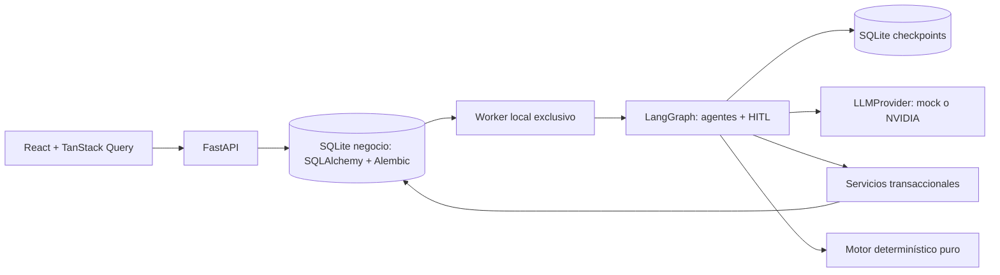
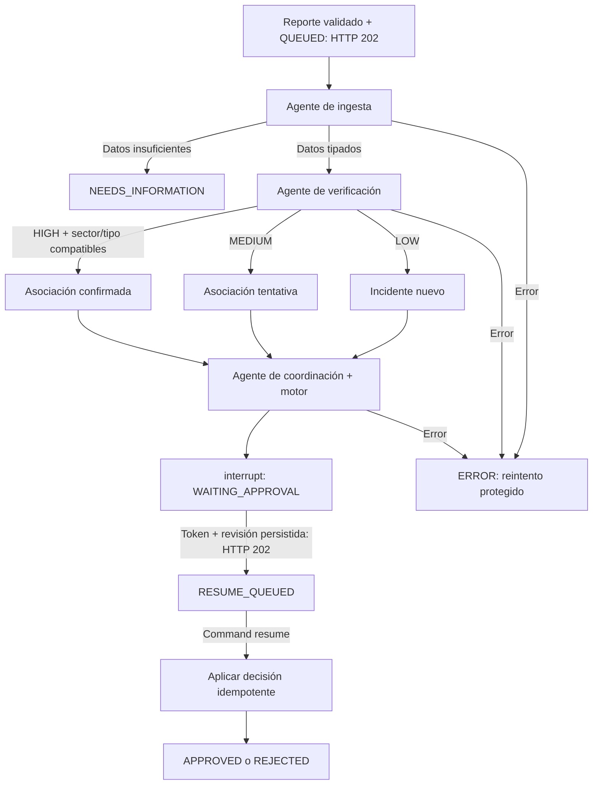

# Arquitectura implementada

Complementa la especificación aprobada en `ARCHITECTURE.md`; no la reemplaza.

## Módulos y datos

`api` solo admite y consulta; `services` y `tools` controlan transacciones; `agents` consume contratos
y herramientas permitidas sin importar ORM; `domain` no importa ORM/LLM; `graph` compone nodos;
`providers` no importa DB.
No hay repositorio genérico ni interfaces por función: `Database.sessions` es la frontera persistente.
`db.checkpoints` encapsula el checkpointer; migrar a PostgreSQL exige instalar driver y saver,
ejecutar migraciones y probarlo. No se afirma compatibilidad PostgreSQL ya verificada.

Tablas: `communities`, `reports`, `incidents`, `associations`, `executions`, `proposals`, `reviews`,
`traces`, `rate_limits`. UUID estables, FK activadas en SQLite, WAL y timeout de 5 s. Una asociación
por reporte, una propuesta y revisión por ejecución. Fechas UTC sin zona en DB, interpretadas como
UTC en UI. Negocio y checkpoints viven en archivos distintos. Solo Alembic crea tablas de negocio.

Fuentes: descripción/horas son declaraciones ciudadanas sin verificación externa; población y
vulnerabilidad del seed son sintéticas explícitas. Campos ausentes conservan null. No se almacenan
coordenadas ni nombres/teléfonos solicitados. El texto libre puede contener PII accidental;
no hay anonimización automática. No registrar texto libre en logs técnicos.

## Política v1.0.0-demo

Pesos configurables mediante `PriorityPolicyConfig`: duración 35, institución crítica 30,
vulnerabilidad 20, población 15; deben sumar 100. Cambios de pesos requieren versión nueva y tests.
Duración: 0 h → 0; (0,12) → 25%; [12,24) → 50%; [24,48) → 75%; ≥48 → 100% del peso.
Redondeo Python al entero más cercano. Población: `min(n/5000,1)*15`;
vulnerabilidad: fracción [0,1]*20. Institución crítica explícita: 30.
Desconocido produce [0,peso], no una resta. Suma de intervalos = `score_min/score_max`.
Confianza HIGH sin factores ausentes, MEDIUM con 1–2, LOW con 3–4. Centro crítico activa alerta.

Cada propuesta conserva la instantánea de su reporte y del catálogo al calcularse. No se suman
duplicados ni se usa su cantidad como población. Aprobación acepta explícitamente el límite inferior;
CORRECT guarda una puntuación humana aparte, sin alterar el cálculo original. Empates conservan
igual puntuación: no hay desempate ni asignación automática de recursos.

## Dedupe e incertidumbre

Filtro SQL: mismo sector, estado OPEN/PRIORITIZED, actividad dentro de 72 h (configurable 48–168).
Máximo 20 candidatos recientes. Texto normalizado exacto y tipo igual confirma; el resto usa
contrato categórico. UUID y compatibilidad se verifican antes de escribir. MEDIUM solo guarda
asociación tentativa; el coordinador confirma o crea incidente distinto. Rechazo no cierra un
incidente que puede tener otros reportes. Incidentes antiguos quedan fuera de ventana salvo nueva
actividad. El mock semántico es una regla por categorías, no una medida de exactitud de un LLM.

## API pública y administración

OpenAPI real: `http://127.0.0.1:8000/docs`. Públicos: health, comunidades, POST reports y estado
mínimo de ejecución por UUID. POST exige `Idempotency-Key` UUID; reutilizarlo con otro payload da 409.
Todo listado, detalle con trazas, retry y resume exige `X-Coordinator-Token`.
Resume exige razón; CORRECT exige entero 0–100. Conflictos devuelven 409, validación 422,
sin token 401, falta configuración segura 503, límite de reportes 429, cuerpo >8 KiB 413.
Polling de ejecución: 2 s activa, 5 s pendiente humana, detenido al terminar/desmontar.
Los listados administrativos siguen a 5 s para descubrir reportes nuevos y tienen paginación.

## Evolución

Planificación futura consume decisiones APPROVED con `incident_id`, `final_score`, factores,
versión y marcas de origen. Su contrato de entrada agregará flota/capacidad/horarios reales y un
nuevo HITL; no se creó un solver vacío. Otros agentes se agregan como nodos/subgrafos.
Observabilidad futura puede sustituir `services.log_event` y exportar `Trace`; separar eventos
`technical` de `audit`. Nunca almacenar cadena privada de razonamiento.

## Referencias verificadas

- [LangGraph: persistencia](https://docs.langchain.com/oss/python/langgraph/persistence)
- [LangGraph: interrupt](https://reference.langchain.com/python/langgraph/types/interrupt)
- [NVIDIA DeepSeek V4.1 Flash](https://build.nvidia.com/deepseek-ai/deepseek-v4.1-flash/build)
- [NVIDIA Kimi K3](https://build.nvidia.com/moonshotai/kimi-k3)

Las firmas reales de `AsyncSqliteSaver.from_conn_string`, `Command` y `interrupt` se comprobaron
en las dependencias instaladas; las pruebas ejecutan esa API. El catálogo NVIDIA no demuestra
acceso efectivo: credenciales y disponibilidad del endpoint deben validarse antes de demo real.

Prueba operativa posterior: [NVIDIA_SMOKE](NVIDIA_SMOKE.md). Se verificó GPT-OSS-20B a través
de NIM. El adaptador solicita JSON mediante el esquema en instrucciones y valida con Pydantic;
omite `response_format` porque el modo JSON del endpoint probado agotó el timeout. Una salida
que no cumpla el contrato sigue fallando de forma explícita. La elección del modelo es configuración,
no cambia la topología ni permite modificar la puntuación determinística.
