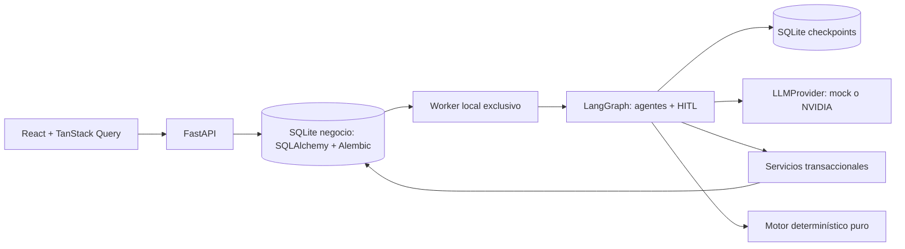
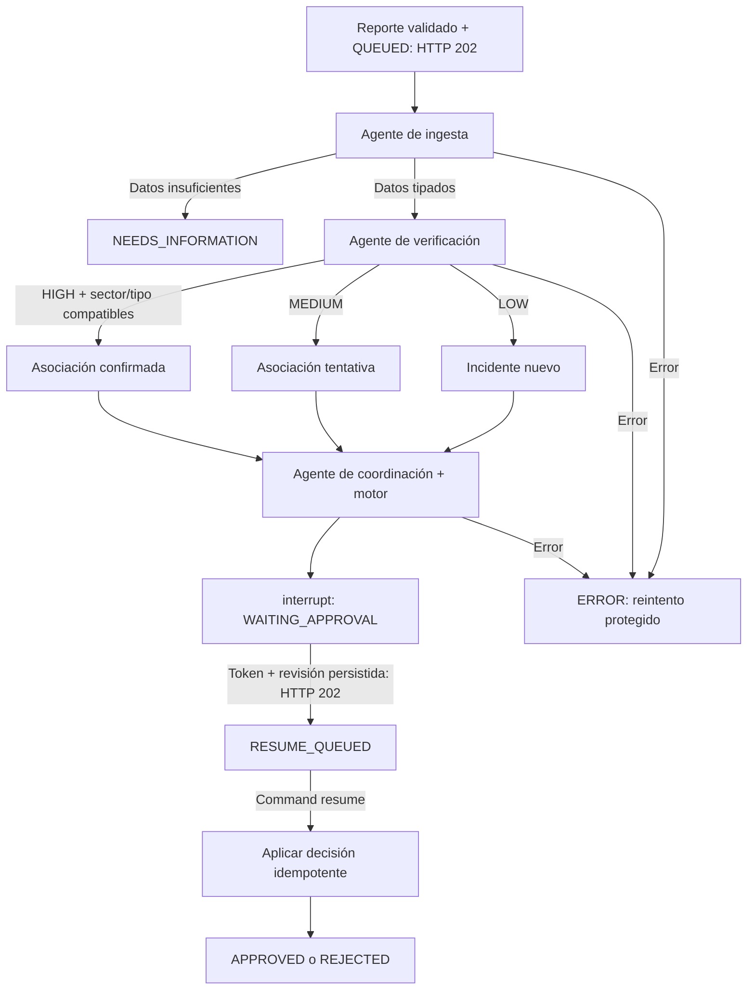

# Arquitectura implementada

Complementa la especificación aprobada en `ARCHITECTURE.md`; no la reemplaza.

## Integración del frontend · 2026-10-17 (AG-52)

La adopción pendiente de AG-41 descrita abajo está implementada: CitizenPage envía los cuatro
`duration_bucket` o null, sin horas representativas (también los ejemplos mock). `Detail.report`
resuelve descripción, duración y comunidad antes de tener propuesta; `Priority.inputs` alimenta
los datos usados por el motor, sin sustituirlos por el catálogo actual. Los campos nuevos son
opcionales en TS para históricos. No cambian Pydantic, OpenAPI, migraciones ni contratos HTTP.

Coordinación separa Vista operativa y Auditoría, accesible como pestaña principal y desde cada
reporte. Conserva formulario al alternar estas dos vistas. Rango sin promedio preseleccionado;
APPROVE exige elegir el entero admitido, CORRECT y REJECT conservan sus cuerpos y confirmación.
Una revisión registrada no aparece aplicada hasta que consta `applied_at`; error de procesamiento
y aplicación se muestran por separado. No se modificaron compuertas HITL ni procesos de agentes.

La auditoría muestra nodos/eventos persistidos, entradas originales/normalizadas, snapshot,
fórmula de la versión conocida, propuestas, flags, asociación, evidencia, revisión y enlace a
planes que constan en el timeline. JSON bajo demanda, sin exportar token ni hash del reporte.
No consulta ni expone razonamiento privado. Las explicaciones históricas sin inputs llevan
advertencia y no alimentan el resumen operativo. No se inventan nodos/transiciones ausentes.

`API_PROXY_TARGET` configura el proxy Vite; por defecto coincide con el README (8000).
Producción conserva HTTP del mismo origen `/api`. Mapa y PlanPanel se reutilizan sin cambios.
Detalle UX, límites del timeline y resultados: [UI](UI.md), [evidencia AG-52](evidence/ag52/README.md).

## Auditoría de integridad · 2026-10-17 (AG-41)

Alcance: backend, contratos, migración, pruebas y evals en `audit-langgraph`. Sin cambios al
frontend, solver, pesos, umbrales ni aprobaciones. El estado inicial de Git estaba limpio.
Lectura: arquitectura D1–D7, catálogo, guardrails, mensajería, pruebas, prompts y consumidores TS.

### Implementación real y contratos de LangGraph

Hay cinco responsabilidades operativas: Ingesta, Verificación, Coordinación, Planificador y
Comunicación. `Agents` agrupa las primeras tres; las otras tienen clases propias. El grafo de
reportes tiene seis nodos, no cinco agentes LLM ni un supervisor conversacional:

| Nodo | Entrada → salida | Operación y persistencia |
|---|---|---|
| ingestion | execution_id → normalized | LLM tipa el problema; grounding valida duración/criticidad; save_normalized idempotente |
| verification | normalized → incident_id, association_status | SQL + comparación exacta o LLM categórico; UUID/sector/tipo/ventana revalidados antes de escribir |
| coordination | reporte + catálogo → priority | Motor puro + inputs + plantilla; save_proposal idempotente, sin LLM |
| insufficient | kind UNKNOWN → terminal | NEEDS_INFORMATION, sin propuesta |
| human_review | priority → review | interrupt sin mutaciones; ReviewInput valida Command(resume) |
| finalize | revisión autorizada → terminal | apply_decision transaccional/idempotente; APPROVED o REJECTED |

`WorkflowState` es un TypedDict parcial: `execution_id`, `normalized`, `incident_id`,
`association_status`, `priority`, `review`, `terminal`. Los objetos internos son diccionarios
serializables; Pydantic valida las salidas del proveedor y la revisión. El motor genera PriorityResult.
No hay reducers, llamadas de un agente a otro, herramientas del sistema ni ORM expuesto al modelo.

La API confirma reporte/ejecución juntos antes de devolver 202; nunca ejecuta el grafo. Telegram
y WhatsApp guardan mensajes/borradores, conducen un chatbot determinista y usan `submit_report`
con el UUID del borrador como clave idempotente. Ambos llegan a la misma cola. WhatsApp requiere
credenciales Meta y sus pruebas son simuladas. Las fotos tienen una tarea orientativa en el worker;
no cambian tipo, horas, puntaje ni constituyen verificación geográfica. No hay transcripción de audio.

El worker usa un lock del SO, una ejecución a la vez y un `thread_id` estable. Recupera RUNNING
al iniciar, reanuda checkpoints con `None` o `Command(resume=review)` y publica el estado terminal
después del checkpoint. Negocio y checkpoint son archivos separados: los efectos de nodos y
finalize deben seguir siendo idempotentes. No hay transacciones abiertas esperando un LLM/humano.
Los errores dejan ERROR, nodo y clase de excepción visibles; el reintento requiere ruta protegida.
El SDK reintenta transporte como máximo dos veces con timeout configurable (30 s por intento);
el grafo no tiene reintentos semánticos infinitos. No hay fallback a mock y se comprueba la identidad
del proveedor al retomar. Respuestas truncadas o con refusal fallan incluso si contienen JSON válido.

Esto concuerda con [interrupts](https://docs.langchain.com/oss/python/langgraph/interrupts) y
[persistencia](https://docs.langchain.com/oss/python/langgraph/persistence): resume reutiliza
thread_id y reinicia el nodo interrumpido. Se verificó además con las dependencias bloqueadas y
pruebas de reinicio de procesos, commit previo a checkpoint y replay de efectos.

Planificador y Comunicación corren fuera de ese grafo, en el mismo worker. El primero consume
solo prioridades autorizadas; un segundo HITL autoriza el plan. Comunicación crea avisos únicos
por plan/comunidad. APPROVED/SCHEDULED no significan que se entregó agua. No existe un agente
separado de corroboración externa ni verificación de campo; deduplicar no certifica el reporte.

### Hallazgos y causas

| Gravedad | Caso y causa demostrada | Corrección / límite |
|---|---|---|
| Alta | La explicación libre podía inventar unidades/hechos: su contrato solo validaba texto y el contexto omitía población/vulnerabilidad. El antecedente NIM de 26 puntos → «26 horas» está en NVIDIA_SMOKE.md | Plantilla con instantánea, sin llamada al proveedor. E59 prueba 2630 habitantes, 8 puntos, criticidad 0–30 y vulnerabilidad no confirmada |
| Alta | El ciudadano seleccionaba un intervalo, pero CitizenPage enviaba 6/18/36/48 como horas; no existía campo para conservar la selección | duration_bucket opcional + migración. No se reconstruyen intervalos antiguos por adivinar el número |
| Alta | stated_hours leía «menos de medio día» como 12, «entre uno y dos días» como 48 y «entre 12 y 24 horas» como 24 | Límites/rangos se marcan imprecisos y no se usan como horas exactas; E60–63 fallaron antes del arreglo |
| Alta | apply_decision devolvía a PRIORITIZED un incidente ya SCHEDULED al aprobar un duplicado; podía volver a entrar al plan | Conservar SCHEDULED. Regresión con plan aprobado y segundo reporte; solver intacto |
| Media | Normalización nula descartaba horas explícitas del texto aunque el parser ya las conocía | Usar la única duración sustentada cuando no hay declaración estructurada contradictoria; E64 |
| Media | El mock confirmaba HIGH solo por tipo/sector; filtro de tipo posterior al límite de 20 podía ocultar un candidato válido | Mock no exacto propone MEDIUM; filtrar tipo en SQL antes del límite; omitir llamada sin candidatos; validar UUID/compatibilidad otra vez |
| Media | Propuestas guardaban puntos sin la población/vulnerabilidad originales; un cambio de seed impedía reconstruir esos valores | priority.inputs conserva valores usados y procedencia de duración. Replay no vuelve a leer catálogo para propuestas existentes |
| Media | JSON completo por casualidad podía aceptarse aunque NIM terminara por límite de tokens/refusal; flags del modelo podían fingir procedencia | Rechazar finalización incompleta; flags de auditoría derivadas en backend, sin confiar en las del modelo |
| Media | El detalle administrativo no incluía el reporte. ReportsPanel buscaba sus horas en otra consulta de timeline y convertía undefined en «No disponible» | Añadir report al detalle protegido. La adopción en UI está pendiente; el mensaje no demuestra pérdida del dato en DB |

Reproducción aritmética con política vigente: primer tramo → round(35×0.25)=9 puntos;
población 2630 → round(2630/5000×15)=8; criticidad desconocida → [0,30]; vulnerabilidad
desconocida → [0,20]. Total [17,67]. No son 9 horas, 8000 habitantes ni 30 % de instituciones.
MEDIUM significa exactamente 1–2 factores ausentes; no hay umbrales de urgencia baja/media/alta
en el backend. No se cambia esa confianza ni se clasifica el rango por su promedio. RF16 ya exige
puntaje humano explícito dentro del rango para APPROVE; CORRECT conserva su puntaje por separado.

No se tuvo la base ni la respuesta NIM de los reportes observados por el usuario: no se atribuye
una respuesta concreta de 8k a una ejecución real nueva. Se demostraron las rutas de pérdida de
semántica y ausencia de validación, y los casos controlados; el «No disponible» exacto también
puede requerir revisar el error/caché del timeline en el navegador. No se ejecutó el frontend.

### Contrato compatible y trabajo posterior del frontend

Antes: `{"community_id":"arraijan-demo","description":"Sin agua en el sector","hours_without_water":6}`.
Después (opcional):

```json
{"community_id":"arraijan-demo","description":"Sin agua en el sector","duration_bucket":"LT_12H"}
```

| duration_bucket | Semántica para los tramos ya aprobados | Puntos con peso 35 |
|---|---|---|
| LT_12H | 0 < duración < 12 h | 9 |
| H12_24 | 12 ≤ duración < 24 h | 18 |
| H24_48 | 24 ≤ duración < 48 h | 26 |
| GE_48H | duración ≥ 48 h | 35 |
| null/omitido, sin horas | No lo sé | [0,35] |

La interfaz deberá aclarar que 24 h pertenece al siguiente tramo; no se cambian los límites de
D5. Horas exactas y bucket juntos devuelven 422. Comparar horas explícitas del texto con el bucket
detecta contradicciones; una declaración compatible conserva el intervalo sin inventar una hora.
Intervalos libres no estructurados se conservan en description y reciben DURACION_IMPRECISA;
la implementación no intenta resolver todos los rangos del lenguaje natural. «No lo sé» nunca es 0.

`ReportInput` publica el campo opcional en OpenAPI. El grafo conserva el campo normalizado y
`priority.inputs` guarda community_id, hours_without_water, duration_bucket, duration_source
(CITIZEN/TEXT/UNKNOWN/CONFLICT), critical_institution, population, vulnerability e is_synthetic.
Criticidad textual/catalogada se distingue con CRITICIDAD_TEXTO/CRITICIDAD_CATALOGO, calculadas
por el backend. Los puntos permanecen en factors y el resultado humano en final_score.
GET protegido `/api/admin/executions/{id}` añade report (incluye campos originales y normalized);
el timeline añade duration_bucket. La ruta pública no expone reporte ni instantánea.

Cambios TS/UI pendientes (no aplicados en este worktree): añadir el union de buckets a la petición,
enviar el bucket en vez de sus representantes 6/18/36/48, leer detail.report para datos declarados
y proposal.priority.inputs para datos usados en el cálculo, con null/ausencia para históricos;
mostrar la etiqueta del intervalo y distinguirla de puntos; usar la instantánea para población
y vulnerabilidad de una propuesta antigua, en vez del catálogo vigente. Añadir fixtures/pruebas
de esos campos y retirar la dependencia del timeline para consultar la duración de un reporte.
La UI actual continúa enviando números: el backend no puede saber si 6 era exacto o representativo.

Aplicar `uv run alembic upgrade head` antes de iniciar API/worker sobre una DB existente.
Migración nueva e7a4c2d9b610; no se editan migraciones desplegadas ni se rellenan duraciones.
Se omite duration_bucket null del hash para conservar Idempotency-Key anteriores. Los campos
nuevos de normalización/priority son opcionales para leer checkpoints existentes. Propuestas,
explicaciones y decisiones históricas no se reescriben; sin inputs no se afirma procedencia nueva.
El protocolo interno retira explain_priority_proposal y CoordinationProposalSchema: los
consumidores internos y fixtures se actualizan juntos, sin cambio de endpoint existente.

### Automatización selectiva: propuesta, no implementada

Mantener automática la validación, normalización sustentada, cálculo, explicación y asociación
exacta compatible de D4. HIGH semántico continúa sujeto a su guardrail; MEDIUM y contradicciones
requieren resolver CONFIRM/NEW. No hay nuevas aprobaciones automáticas en esta entrega.

Una política que se puede evaluar en modo sombra: candidato únicamente si score_min=score_max,
sin alerta crítica, sin contradicciones, todos los datos con fuente confirmada y sin asociación
tentativa; ante cualquier ausencia, desacuerdo de fuentes, error o institución crítica, revisión.
Registrar elegibilidad y decisión humana en un corpus autorizado antes de discutir autoaprobación.
No fijar un umbral de «bajo riesgo» sin acuerdo del dominio: hoy no existe. Flota, plan y todo cambio
de distribución conservan autorización humana incluso si el análisis se automatiza. Solo tras
validación humana del corpus y autorización expresa tendría sentido cambiar una compuerta.

No se recomienda agregar agentes: imágenes ya tienen tarea de proveedor; ubicación puede
validarse con catálogos/coordenadas reales mediante una función cuando existan; inconsistencias
y explicaciones necesitan validadores deterministas. La logística ya tiene solver y dos HITL.
Un agente de geografía o multimedia autónomo no sustituye evidencia externa ni su procedencia.
Un nuevo rol solo se justificaría con herramientas/fuentes y una evaluación que superase estas
funciones; no se añaden llamadas LLM para revisar cifras que el motor ya conoce.

Límites abiertos: sector del catálogo no equivale a coordenadas del incidente; last_activity
no es inicio del corte, no hay identificador externo común ni sensores; similitud semántica NIM
requiere pares humanos anotados antes de publicar precision/recall. La criticidad textual sigue
siendo una regla léxica orientativa. El tipo escogido en mensajería sigue embebido en el texto
(deuda ya documentada en MESSAGING.md). El worker único y su orden de colas no garantizan latencia
de planes/fotos ante una llegada indefinida de reportes. No se cambian esas políticas sin evidencia.





## Módulos y datos

`api` solo admite y consulta; `services` y `tools` controlan transacciones; `agents` consume contratos
y herramientas permitidas sin importar ORM; `domain` no importa ORM/LLM; `graph` compone nodos;
`providers` no importa DB.
No hay repositorio genérico ni interfaces por función: `Database.sessions` es la frontera persistente.
`db.checkpoints` encapsula el checkpointer; migrar a PostgreSQL exige instalar driver y saver,
ejecutar migraciones y probarlo. No se afirma compatibilidad PostgreSQL ya verificada.

Tablas: `communities`, `reports`, `incidents`, `associations`, `executions`, `proposals`, `reviews`,
`traces`, `rate_limits`. UUID estables, FK activadas en SQLite, WAL y timeout de 5 s. Una asociación
por reporte, una propuesta y revisión por ejecución. Fechas UTC sin zona en DB, interpretadas como
UTC en UI. Negocio y checkpoints viven en archivos distintos. Solo Alembic crea tablas de negocio.

Fuentes: descripción/horas son declaraciones ciudadanas sin verificación externa; población y
vulnerabilidad del seed son sintéticas explícitas. Campos ausentes conservan null. No se almacenan
coordenadas ni nombres/teléfonos solicitados. El texto libre puede contener PII accidental;
no hay anonimización automática. No registrar texto libre en logs técnicos.

## Política v1.0.0-demo

Pesos configurables mediante `PriorityPolicyConfig`: duración 35, institución crítica 30,
vulnerabilidad 20, población 15; deben sumar 100. Cambios de pesos requieren versión nueva y tests.
Duración: 0 h → 0; (0,12) → 25%; [12,24) → 50%; [24,48) → 75%; ≥48 → 100% del peso.
Redondeo Python al entero más cercano. Población: `min(n/5000,1)*15`;
vulnerabilidad: fracción [0,1]*20. Institución crítica explícita: 30.
Desconocido produce [0,peso], no una resta. Suma de intervalos = `score_min/score_max`.
Confianza HIGH sin factores ausentes, MEDIUM con 1–2, LOW con 3–4. Centro crítico activa alerta.

Cada propuesta nueva conserva las entradas efectivas en `priority.inputs` (las anteriores podían
conservar solo factores). No se suman duplicados ni se usa su cantidad como población.
Un rango exige `approved_score` explícito dentro de él; una propuesta fija acepta su valor;
CORRECT guarda una puntuación humana aparte, sin alterar el cálculo original. Empates conservan
igual puntuación: no hay desempate ni asignación automática de recursos.

## Dedupe e incertidumbre

Filtro SQL: mismo sector y tipo, estado OPEN/PRIORITIZED/SCHEDULED, actividad dentro de 72 h
(configurable 48–168), aplicado antes del límite de candidatos.
Máximo 20 candidatos recientes. Texto normalizado exacto y tipo igual confirma; el resto usa
contrato categórico. UUID y compatibilidad se verifican antes de escribir. MEDIUM solo guarda
asociación tentativa; el coordinador confirma o crea incidente distinto. Rechazo no cierra un
incidente que puede tener otros reportes. Incidentes antiguos quedan fuera de ventana salvo nueva
actividad. Sin candidatos no se invoca al modelo. El mock propone MEDIUM para textos distintos
del mismo tipo/sector: esa coincidencia no prueba identidad. Una duración contradictoria rebaja
HIGH a MEDIUM en la herramienta de escritura. El mock no mide exactitud de un LLM.

## API pública y administración

OpenAPI real: `http://127.0.0.1:8000/docs`. Públicos: health, comunidades, POST reports y estado
mínimo de ejecución por UUID. POST exige `Idempotency-Key` UUID; reutilizarlo con otro payload da 409.
Todo listado, detalle con trazas, retry y resume exige `X-Coordinator-Token`.
Resume exige razón; CORRECT exige entero 0–100. Conflictos devuelven 409, validación 422,
sin token 401, falta configuración segura 503, límite de reportes 429, cuerpo >8 KiB 413.
Polling de ejecución: 2 s activa, 5 s pendiente humana, detenido al terminar/desmontar.
Los listados administrativos siguen a 5 s para descubrir reportes nuevos y tienen paginación.

## Evolución

La planificación implementada consume decisiones aprobadas con `incident_id` y `final_score`,
flota y ubicaciones del catálogo, y tiene su propia revisión humana del plan. Ver catálogo de
agentes y README. Sustituir los supuestos de demo por datos operativos reales exige validarlos
sin atribuir oficialidad a los pesos actuales. Otros agentes se agregarían solo si aportan una
responsabilidad demostrada, como nodos/subgrafos.
Observabilidad futura puede sustituir `services.log_event` y exportar `Trace`; separar eventos
`technical` de `audit`. Nunca almacenar cadena privada de razonamiento.

## Referencias verificadas

- [LangGraph: persistencia](https://docs.langchain.com/oss/python/langgraph/persistence)
- [LangGraph: interrupt](https://reference.langchain.com/python/langgraph/types/interrupt)
- [NVIDIA DeepSeek V4.1 Flash](https://build.nvidia.com/deepseek-ai/deepseek-v4.1-flash/build)
- [NVIDIA Kimi K3](https://build.nvidia.com/moonshotai/kimi-k3)

Las firmas reales de `AsyncSqliteSaver.from_conn_string`, `Command` y `interrupt` se comprobaron
en las dependencias instaladas; las pruebas ejecutan esa API. El catálogo NVIDIA no demuestra
acceso efectivo: credenciales y disponibilidad del endpoint deben validarse antes de demo real.

Prueba operativa posterior: [NVIDIA_SMOKE](NVIDIA_SMOKE.md). Se verificó GPT-OSS-20B a través
de NIM. El adaptador solicita JSON mediante el esquema en instrucciones y valida con Pydantic;
omite `response_format` porque el modo JSON del endpoint probado agotó el timeout. Una salida
que no cumpla el contrato sigue fallando de forma explícita. La elección del modelo es configuración,
no cambia la topología ni permite modificar la puntuación determinística.
