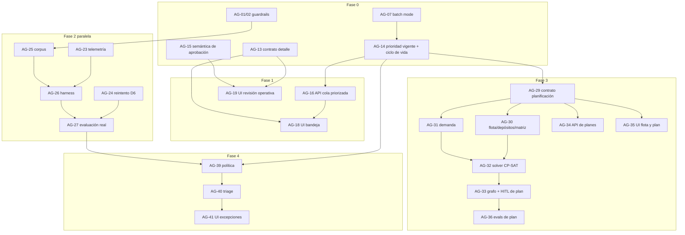

# Hoja de ruta

Actualizada el 2026-10-16 a partir de la auditoría [GAP_ANALYSIS](GAP_ANALYSIS.md).
Tareas detalladas: [BACKLOG](BACKLOG.md). Arranque: [NEXT_STEPS](NEXT_STEPS.md).
La hoja de ruta anterior se conserva íntegra en el [Apéndice A](#apéndice-a--hoja-de-ruta-anterior-preservada).

Principios:
- completar el **flujo esencial de distribución de agua** antes de funcionalidades secundarias;
- respetar D1–D7 y ADR 001;
- no introducir infraestructura nueva (ni microservicios ni broker);
- toda decisión de recursos pasa por una persona.

## Cambio de orden respecto a la propuesta inicial

La propuesta inicial ordenaba las fases así: 0 auditoría → 1 NVIDIA → 2 automatización →
3 cisternas → 4 mapa → 5 comunicación/multimodal → 6 cierre. Se ajusta por tres dependencias
verificadas:

1. **Falta la «Fase 1: incidente como unidad operativa».** Tanto la automatización por excepciones como
   el planificador necesitan una **prioridad vigente por incidente**, una cola priorizada y el cierre
   de incidentes. Hoy la prioridad existe solo por reporte (D-09, D-10, D-11).
2. **NVIDIA pasa a ser una pista paralela.** Toca `providers.py` y `evals/`, módulos distintos de los
   de las fases 1 y 3. Además requiere autorización de cuota, que puede tardar.
3. **La distribución (Fase 3) va antes que la automatización (Fase 4).** Es el núcleo del reto; la
   automatización reduce trabajo pero arriesga el requisito HITL. Además, la regla de automatización
   R8 depende de los resultados de la evaluación real.

## Fases

| Fase | Objetivo | Tareas | Criterio de salida verificable | Esfuerzo aprox. |
|---|---|---|---|---|
| **0. Estabilización y contratos** | Corregir defectos P0 y acordar los contratos que desbloquean el trabajo paralelo | AG-01 a AG-15 | Frases de D-01/D-02 cubiertas por pruebas; CI remoto verde en Windows y Linux; `render_as_batch` activo; ADR-002 y ADR-003 aprobadas; contrato AG-13 integrado | ≈ 6.5 personas-día |
| **1. Incidente como unidad operativa** | El coordinador ve una cola priorizada con evidencia y decide en lenguaje operativo | AG-16 a AG-22 | Cola ordenada por prioridad vigente; detalle con texto del reporte y comunidad, sin UUID visibles; aprobación coherente con D5; incidentes cerrables; auditoría a11y | ≈ 5 p-d |
| **2. Evaluación real NVIDIA** (paralela) | Medir calidad real y elegir modelo con datos | AG-23 a AG-28 | Informe comparativo (DeepSeek V4.1 Flash, Kimi K3, GPT-OSS-20B, mock) con las métricas de GAP §6.2, separado de las evals mock | ≈ 4 p-d |
| **3. Cisternas y distribución** | Producir planes factibles de asignación con aprobación humana | AG-29 a AG-36 | Corrida de plan sintética de punta a punta: 202 → solver → `interrupt` → aprobado; ≥ 8 evals de planificación; UI de flota y plan; datos sintéticos rotulados | ≈ 9.5 p-d |
| **4. Supervisión por excepciones** | Reducir revisiones rutinarias sin perder el HITL | AG-39 a AG-42 | Modo `exceptions` detrás de bandera; `all_human` por defecto; 22 evals intactas; evals E23+ para rutas AUTO y HUMANO; reversión probada | ≈ 3.5 p-d |
| **5. Geo, comunicación y multimodal** | Extensiones condicionadas a datos y autorizaciones | AG-43 a AG-46, AG-52 | Solo si existe la fuente o autorización; sin geografía inventada | P2 |
| **6. Cierre y operación** | Seguridad, validación de datos, despliegue y demo final | AG-47 a AG-51 (AG-49 es continuo) | Video ≤ 3 min; checklist; tag autorizado; identidad individual antes de cualquier uso real | ≈ 6 p-d |

Estimaciones (escala de [BACKLOG](BACKLOG.md): XS ≤ 2 h, S ≈ medio día, M ≈ 1 día, L ≈ 2–3 días).
El total P0+P1 ronda 30 personas-día, unos 10–11 días hábiles con tres personas. Son estimaciones
para dividir trabajo, no compromisos.

## Dependencias y ruta crítica

**Ruta crítica:** AG-07 → AG-14 → AG-29 → AG-30/AG-31 → AG-32 → AG-33 → AG-36.
AG-34 y AG-35 avanzan en paralelo usando el contrato de AG-29 con fixtures.

## Pistas paralelas por rol

| Pista | Fase 0 | Fase 1 | Fase 3 | Fase 4 |
|---|---|---|---|---|
| A: backend, datos y API | AG-07, AG-13, AG-14, AG-04, AG-06, AG-08, AG-10 | AG-16, AG-17 | AG-29 (con B), AG-30, AG-31, AG-34 | AG-42 |
| B: agentes, IA y evals | AG-01, AG-02, AG-03, AG-05, AG-15 | AG-21 | AG-32, AG-33, AG-36 | AG-39, AG-40 |
| C: frontend, UX y demo | AG-12, preparación de glosario y maquetas | AG-18, AG-19, AG-22 | AG-35 | AG-41 |
| B (Fase 2, en paralelo) | — | AG-23 a AG-27 en cuanto haya autorización | — | — |

La pista B está más cargada en las fases 2 y 3. Si hace falta, A toma AG-31 y AG-36, y C toma AG-25
(anotación del corpus).

## Corte de entrega `final-24h`

La plantilla oficial fija la entrega «al cumplirse la hora 24», pero el repositorio no registra la hora
de inicio. **Confirmar el plazo antes de planificar.**

| Si el congelamiento es… | Alcance recomendado antes del tag |
|---|---|
| Inminente (< 1 día) | AG-01, AG-02 (guardrails), AG-12 (docs honestas), AG-13 más un cambio mínimo de UI que muestre el texto del reporte, AG-10 si se autoriza, **AG-49 (video y checklist)**. No empezar la Fase 3 a medias. |
| 2–4 días | Lo anterior + AG-14, AG-15, AG-16, AG-18 + una **Fase 3 mínima**: AG-29, AG-30 con seed sintético, AG-32, AG-33 y una UI simple de AG-35. Evals de plan reducidas. |
| > 1 semana | Fases 0–4 completas; Fase 2 con autorización de cuota; P2 posterior. |

Regla: nunca etiquetar `final-24h` sobre un commit con una fase a medio integrar. `main` siempre
ejecutable.

## Riesgos de la hoja de ruta

Los riesgos de la hoja anterior siguen vigentes (Apéndice A). Se añaden R1–R12 de
[GAP_ANALYSIS §12](GAP_ANALYSIS.md#12-riesgos-arquitectónicos). Los más relevantes para el orden:

- R1: sin prioridad vigente por incidente, el planificador no tiene una entrada fiable;
- R2: decisiones de modelo tomadas sobre el mock;
- R6: migraciones paralelas;
- R11: dispersión de alcance;
- R12: plazo.

---

## Apéndice A — Hoja de ruta anterior (preservada)

| Etapa | Estado | Salida y dependencias |
|---|---|---|
| Fundación | Implementada localmente | Monorepo, contratos, migraciones, locks, controles de calidad y documentación |
| Vertical slice | Implementado en demo | Tres agentes, cola durable, prioridad, HITL real y UI; pruebas descritas en EVALUATION |
| MVP del hackathon | Parcial | Validar NIM con credenciales, revisión humana, CI remoto, datos/contexto validado y video |
| Planificación de recursos | Pendiente | Contrato de flota/capacidad/horarios; OR-Tools + nuevo HITL; requiere datos confiables |
| Canales y geografía | Pendiente | Geolocalización, mapa, WhatsApp/Telegram, audios/imágenes; consentimientos e integraciones reales |
| Operación pública | Pendiente | Roles individuales, privacidad/retención, HTTPS, carga, backups y migración a PostgreSQL cuando haga falta |

Orden recomendado: verificar demo y NIM → revisar seguridad/datos → ejecutar CI y preparar video →
planificador mínimo con datos sintéticos → integrar una fuente real autorizada. No añadir predicción
antes de tener histórico y una métrica que justifique su utilidad.

Riesgos: falsa consolidación semántica, confusión entre datos sintéticos/reales, catálogo no validado,
disponibilidad/latencia de modelos, token compartido, pérdida de consistencia si se copian archivos
de DB activos por separado. Mitigaciones actuales y límites: GUARDRAILS y ADR 001.

Diferencia con la versión actual: el «planificador mínimo con datos sintéticos» se adelanta y se
precede de la prioridad vigente por incidente (AG-14), que la versión anterior no contemplaba.
